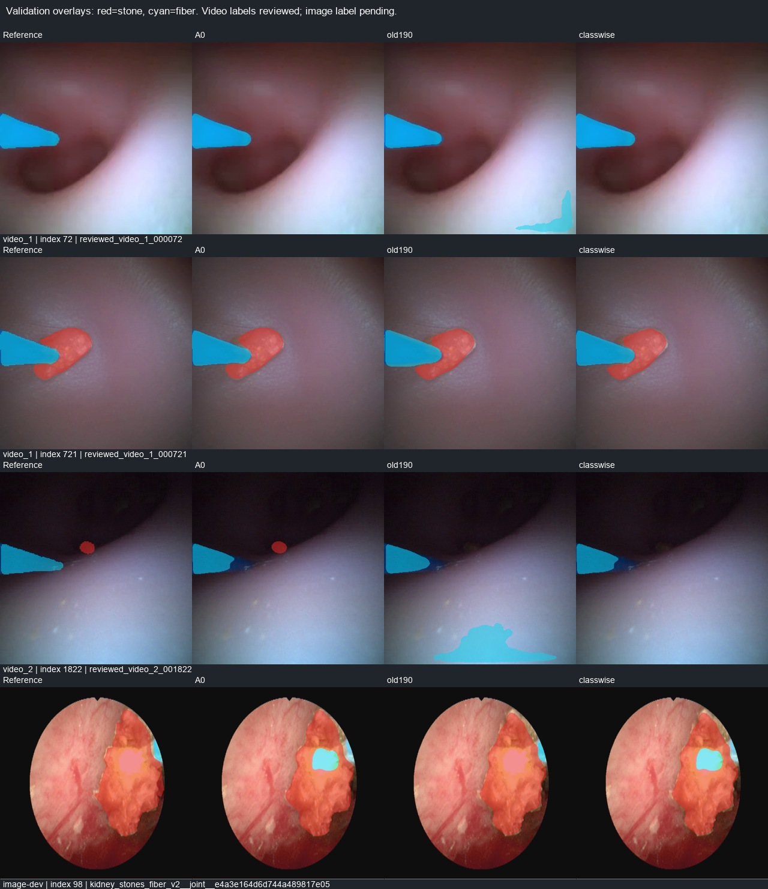

# S2 现有专家按类别分工对照

2026-10-28。**已完成，29帧视频的三项预设初筛均通过；尚未验收S2、未替换默认模型。** 组合改善了当前视频上的类别取舍，但仍漏掉小结石，在图像开发集上也没有同时优于其他模型。下一步先完成完整视频回放与总延迟检查，再决定底座及是否需要光纤轻量精修。

## 固定方案与数据

- 结石：历史190张kidney监督训练的单网U-Net256固定末轮，`runs/a1_sup_kidney_resolution_20261028/unet256/last.pt`。
- 光纤：原A0双网，`runs/endosemis/best.pt`。仅用于冻结推理；来源不明，不能用于新训练初始化。
- 每个专家的FP32 softmax概率先双线性映射回原图，再分别argmax。A0预测光纤的位置输出光纤；其余位置保留旧190模型预测的结石，剩余为背景。不扫描阈值、不做形态学处理、不用真值提示、不加入时序平滑。
- 共3个U-Net、73,804,185参数。输出保留两个专家各自的概率图，**没有经过校准的联合三分类概率**。光纤结果按构造与A0完全相同，不能称为重新学会光纤。
- 视频：原29帧审核像素，原图400×400，参考掩膜不缩放；9帧明确无结石。两段视频和所有派生数据始终仅用于开发验证。
- 图像：联合版本132张，来源标签仍待审。25个组曾在历史190训练中曝光，107个组未匹配到该曝光，分别报告。A0来源未知，107组也不等于独立病例测试。v2的640图像在全局像素汇总中比v1的320图像权重大，因此另列来源结果。
- 无训练更新、无标签或划分变更、未读取144个保留test组的像素。stone_new继续退出所有训练用途。

冻结的[原实验协议](../../configs/compare_classwise_experts_20261028.json)保留执行前状态字段，实际执行状态见[job.json](../../runs/a1_classwise_experts_20261028/job.json)。源码、权重、配置、验证输入身份及源码快照随实验保存。

## 视频29帧：原图同口径

| 模型 | 结石Dice | 光纤Dice | 结石Recall | 光纤Recall | 无结石帧误检面积占比 |
|---|---:|---:|---:|---:|---:|
| A0，双网 | 0.4740 | 0.9668 | 0.7405 | 0.9455 | 7.7822% |
| 旧190，单网 | 0.8100 | 0.9038 | 0.7234 | 0.9352 | 0.0331% |
| 联合521，单网 | 0.7695 | 0.8863 | 0.6482 | 0.9435 | 0.0479% |
| **类别分工，三网** | **0.8106** | **0.9668** | **0.7234** | **0.9455** | **0.0331%** |

三项门槛在读取组合指标前由新复现A0固定：结石Dice≥0.4740154、光纤Dice≥0.9568022、无结石帧误检面积≤0.0778222（比例）。组合全部通过。

组合结石TP/FP/FN为66045/5609/25251，光纤为168925/1873/9728；结石Precision为0.9217，光纤为0.9890。负帧仍有1/9帧误检，共477/1,440,000有效像素，不能说误检消失。

相对旧190，光纤优先覆盖116个结石预测像素，其中参考为光纤113、背景3、结石0。因此视频结石TP没有损失，FP减少116；结石Dice仅有很小变化。相对A0，结石FP净减少120721，但TP净减少1556，不能说召回全面提升。

原图3像素容差的结石/光纤边界F：A0为0.5550/0.9171，旧190为0.5669/0.7059，组合为0.5737/0.9171。

| 视频 | A0结石/光纤Dice | 旧190结石/光纤Dice | 组合结石/光纤Dice |
|---|---:|---:|---:|
| video_1 | 0.5802 / 0.9877 | 0.9002 / 0.9370 | 0.9014 / 0.9877 |
| video_2 | 0.3714 / 0.9270 | 0.7144 / 0.8466 | 0.7144 / 0.9270 |

**小目标问题保留。** 原图结石可见总面积≤1024像素仅3帧，共2423个参考结石像素：A0召回0.9583、3/3帧有TP；旧190和组合均为0.7421、2/3帧有TP。video_2零基帧1822（显示帧1823）的625像素结石仍被组合完全漏掉。组合没有利用A0的结石来补这个漏检；不在看到结果后新增融合例外。

## 图像132帧与曝光分组

| 模型 | 全132结石/光纤Dice | 历史190曝光25组 | 未匹配该曝光107组 |
|---|---:|---:|---:|
| A0 | 0.9196 / 0.7623 | 0.9221 / 0.6407 | 0.9191 / 0.7945 |
| 旧190 | 0.9072 / 0.7825 | 0.9083 / 0.8278 | 0.9070 / 0.7730 |
| 联合521 | 0.9057 / 0.8030 | 0.9034 / 0.7959 | 0.9062 / 0.8044 |
| 组合 | 0.9067 / 0.7623 | 0.9068 / 0.6407 | 0.9067 / 0.7945 |

这里没有确认无结石负帧，不计算负帧误检率。不能把视频与图像拼起来算一个“总升级分数”。

组合图像结石Dice略低于旧190：光纤优先总覆盖30753个旧190结石预测，其中17332个是来源参考结石像素，11824为参考背景、1597为参考光纤。相对旧190，结石TP损失17332、FP减少13421。最大单图冲突为v2组`e4a3e164d6d744a489817e05`，覆盖5397个参考结石像素，示例可见A0把结石中的亮区预测为光纤。来源标签待审，记录预测与参考冲突，不自动改标签。

来源分别看，组合v1结石/光纤Dice为0.8924/0.7970，v2为0.9104/0.7443；联合521分别为0.8826/0.8082、0.9114/0.8003。A0的高视频光纤表现不能直接外推到所有图像来源。

## 同轮成本

RTX4070Ti；每种方案独立新进程，batch1，预热12帧，计时87帧。包含缓存BGR输入预处理、全部网络前向、原图概率/类别输出及CPU传输，组合还包含两份专家概率及融合。排除视频解码、磁盘导出、显示、几何和记忆。精度采用PIL缩放，成本采用既有OpenCV预处理，二者明确分开；后续完整回放统一预处理并单列差异。

| 模型 | 网数 / 参数量 | 中位耗时 ms | p95 ms | CUDA峰值分配 MiB |
|---|---:|---:|---:|---:|
| A0 | 2 / 49.20M | 16.01 | 22.51 | 223.92 |
| 旧190 | 1 / 24.60M | 8.22 | 14.20 | 128.77 |
| 联合521 | 1 / 24.60M | 7.65 | 12.95 | 128.77 |
| 组合 | 3 / 73.80M | 20.86 | 33.03 | 319.82 |

组合中位较本轮A0增加约4.85ms，p95已接近30fps单帧33.33ms预算，尚未计解码和显示，不能宣称完整系统稳定实时。以上是本机本轮样本，不能用不同历史实验的耗时替代同轮比较，也没有实时流队列积压测试。

## 验证、交付与下一步

新增3项单元测试通过：类别优先/输入不变、概率先回原图后argmax、三网eval及可变原图批量输出。独立复算26项执行核验均通过，包括161张验证输出的逐像素策略、四组混淆矩阵、冲突计数、25/107曝光划分、输入/源码/权重身份、完整三网计时。未宣称本轮重跑全部历史测试。

- [完整结果与指标](../../runs/a1_classwise_experts_20261028/summary.json)
- [26项执行核验](../../runs/engineering/classwise_experts_checks_20261028.json)
- [示例对应帧/样本](../../runs/a1_classwise_experts_20261028/validation_examples.json)
- [推理组合清单](../../runs/a1_classwise_experts_20261028/predictor_manifest.json)

**下一步仍在S2：** 按[完整回放协议](../../configs/replay_classwise_experts_20261028.json)顺序处理两段验证视频全部2694帧，固定模型和融合，对照A0/旧190/组合；优先导出用户指定的腔壁误检、闪烁和遮挡片段，报告原始面积跳变/有无切换及总延迟。没有稠密真值的帧只做诊断，不能计算真实误检持续时间、实例追踪、遮挡恢复或几何准确率。先检验单帧底座的实际限制，再决定光纤轻量精修或S3后端对照。该回放协议已准备，尚未执行；不新增训练，不改变默认模型。
