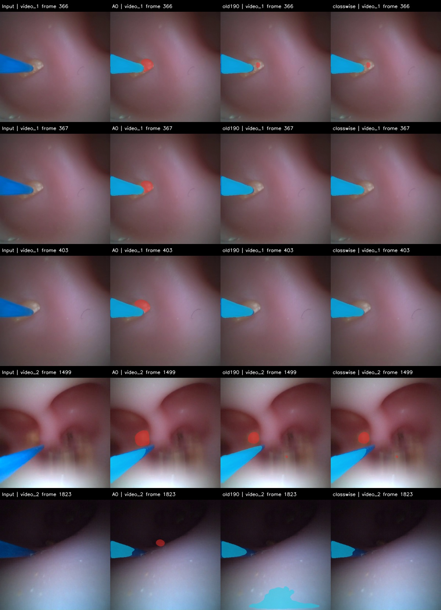

# S2 类别分工模型完整视频回放

2026-10-28。**已完成video_1的722帧、video_2的1972帧，共2694帧。组合维持29帧分割初筛成绩，但仍有结石预测短时消失，三网核心p95接近或超过源视频单帧预算。S2尚未验收，未替换默认模型或启动S3。**

本轮没有训练、阈值搜索、时序融合或标签修改。结石仍来自旧190单网，光纤来自A0双网，光纤优先；三个网络共73,804,185参数，全部以eval和inference mode运行。权重文件及模型内存状态在前后核对一致。原始数据、历史结果与联合521/132/144组及29帧划分不变；stone_new继续禁止训练，保留test像素未读取。

## 回放与对齐

按[执行前冻结协议](../../configs/replay_classwise_experts_20261028.json)从帧0顺序解码，不随机跳帧。视频解码BGR转RGB，采用与NativeValidationDataset一致的PIL双线性256缩放和归一化；各专家概率先映射到原图400×400再argmax。三个前向同时提供A0、旧190、组合三份原图掩膜，未加第四个网络。每段预热12帧并检查同帧掩膜及两份专家概率逐位复现；模型不保存跨帧预测状态，上一帧仅用于事后诊断。

29张审核帧的解码RGB与原冻结PNG逐像素一致。batch1对比上轮batch2，A0和组合全部预测像素一致；旧190仅video_2零基帧149有1个像素差异，其光纤Dice从0.90383294变为0.90383050，未修改阈值或掩盖数值差异。

| 模型 | 29帧结石Dice | 光纤Dice | 无结石帧误检面积占比 |
|---|---:|---:|---:|
| A0 | 0.4740 | 0.9668 | 7.7822% |
| 旧190 | 0.8100 | 0.9038 | 0.0331% |
| 组合 | 0.8106 | 0.9668 | 0.0331% |

组合仍通过原三项开发初筛。原图≤1024结石像素的小目标组仍仅3帧，漏掉1帧；video_2显示帧1823（零基1822）的625像素参考结石没有被补回。132张图像验证本轮未重跑，其组合光纤Dice0.7623及来源/曝光限制仍保留，不能只据视频选出“最优模型”。

## 完整视频的预测变化

以下是**预测代理诊断**，没有逐帧事件或实例真值；原始变化未做运动补偿，受相机运动、视野和曝光影响。不能把有无切换称为真实漏检事件，把面积候选称为腔壁误检，或把变化变小称为遮挡记忆已经有效。

| 视频 / 模型 | 平均相邻标签变化占估计视野比例 | 结石有→无 / 无→有 | 大结石区域候选帧数 |
|---|---:|---:|---:|
| video_1 / A0 | 0.3801% | 5 / 5 | 0 |
| video_1 / 旧190 | 0.1816% | 7 / 7 | 0 |
| video_1 / 组合 | 0.1527% | 7 / 7 | 0 |
| video_2 / A0 | 1.7878% | 11 / 11 | 184 |
| video_2 / 旧190 | 1.0283% | 35 / 35 | 0 |
| video_2 / 组合 | 0.8728% | 35 / 35 | 0 |

“有”定义为至少1个预测像素，没有按验证结果搜索面积阈值。大区域候选沿用A0工作台阈值：预测结石占估计视野>25%。video_1候选为0并不表示不存在用户报告的腔壁误检；这个固定阈值会漏掉更小的错误区域。三个方案的光纤在两段视频均始终有预测，这也不等于杆体/尖端分割或身份连续性通过。

用户给出的video_1区间按一基闭区间解释，逐段导出四栏对照视频（输入、A0、旧190、组合）：

| 区间 | A0有结石预测帧 | 组合有结石预测帧 | A0 / 组合平均相邻标签变化 |
|---|---:|---:|---:|
| 33–37 | 5/5 | 5/5 | 0.1263% / 0.0936% |
| 54–72 | 18/19 | 2/19 | 1.4692% / 0.0832% |
| 77–78 | 1/2 | 0/2 | 0.5825% / 0.0256% |
| 80–113 | 32/34 | 14/34 | 4.0842% / 0.2100% |
| 330–722，光纤遮挡 | 393/393 | 390/393 | 0.1113% / 0.1182% |

遮挡区间中，组合有两次结石有→无：**显示帧367–368，以及403，共3帧为空**（零基366–367、402）。对比图可见旧190结石预测在光纤尖端附近变小后消失；缺少这些帧的像素真值，不能给出真实漏检面积、遮挡恢复率或实例身份结论。组合没有跨帧几何信息，也不会重建被光纤挡住的结石。

## 端到端回放成本

RTX4070Ti，batch1、FP32、每段预热12帧排除；每帧同步CUDA计时。核心包含PIL预处理、全部三网、原图概率映射/argmax/融合及三份掩膜CPU传输；不再把两份专家概率整图传回CPU。与上轮缓存OpenCV预处理成本的口径不同，不能直接拿均值差异宣称提速或退化。

总周期额外包含视频解码、三套诊断/PNG保存、四栏渲染、视频及事件片段写出和逐帧JSONL写入。离线吞吐还计入视频写出最终释放。实际显示、实时输入队列和丢帧没有测试；这里是带审计导出的研发管线成本，不等于生产单栏显示成本。

| 项目 | video_1，30fps | video_2，30.082fps |
|---|---:|---:|
| 源视频每帧预算 | 33.33 ms | 33.24 ms |
| 核心中位 / p95 | 21.76 / 33.20 ms | 23.76 / 34.55 ms |
| 核心超过源帧预算 | 31/722帧 | 196/1972帧 |
| 诊断/对齐检查平均 | 6.18 ms | 6.34 ms |
| 掩膜保存平均 | 1.96 ms | 2.05 ms |
| 四栏渲染及视频写出平均 | 10.55 ms | 9.43 ms |
| 总周期中位 / p95 | 40.98 / 55.20 ms | 42.19 / 54.59 ms |
| 总周期超过源帧预算 | 647/722帧 | 1905/1972帧 |
| 离线吞吐，含导出 | 23.59 fps | 23.23 fps |
| CUDA峰值分配 | 319.82 MiB | 319.82 MiB |

研发回放未达到源视频帧率；即使去掉大量导出，三网核心本身的尾延迟也没有为记忆、几何和显示留下稳定余量。不能据显存较低或平均核心耗时低于33ms就验收实时性。

## 检查与交付

新增3项单元测试通过：PIL输入与验证张量一致、一基区间转零基无偏移、区间内有无切换与变化统计。独立顺序解码并复算全部8082张原图预测掩膜、FOV/面积/相邻变化、区间有无片段、29帧混淆矩阵及batch差异；33项执行核验均通过。五段视频1片段帧数及完整四栏视频编码尺寸/帧数通过检查。不宣称本轮重跑全部历史测试。

- [完整video_1对照](../../runs/a1_classwise_replay_20261028/video_1/comparison.mp4)
- [完整video_2对照](../../runs/a1_classwise_replay_20261028/video_2/comparison.mp4)
- [33–37帧](../../runs/a1_classwise_replay_20261028/video_1/clips/00_wall_flicker_reported_33-37.mp4)、[54–72帧](../../runs/a1_classwise_replay_20261028/video_1/clips/01_wall_flicker_reported_54-72.mp4)、[77–78帧](../../runs/a1_classwise_replay_20261028/video_1/clips/02_wall_flicker_reported_77-78.mp4)、[80–113帧](../../runs/a1_classwise_replay_20261028/video_1/clips/03_wall_flicker_reported_80-113.mp4)
- [330–722帧遮挡区间](../../runs/a1_classwise_replay_20261028/video_1/clips/04_fiber_occlusion_reported_330-722.mp4)
- [完整结果](../../runs/a1_classwise_replay_20261028/summary.json)、[29帧原图复算](../../runs/a1_classwise_replay_20261028/reviewed29.json)、[33项执行核验](../../runs/engineering/classwise_replay_checks_20261028.json)

## 下一步决定

先做一次有限的**现有光纤单成员成本消融**：旧190结石分别搭配A0的model1/model2光纤，把总网络数从3降至2；在原29帧、132张图像及25/107曝光分组上复算，并同轮测全部所需网络的成本，检查能否保留既定光纤门槛。两个成员都预先列出，不搜索新阈值、不训练、不默认采用。该实验只处理成本问题，旧190未识别到的结石仍无法补回，不承诺消除上述短时消失。

如果两个成员都不能保留质量，就结束成员搜索，回到原计划的光纤轻量精修可行性设计；不自动扩展训练预算。通过者也须结合图像来源冲突和完整回放再决定底座。准备协议为[两网成员对照](../../configs/compare_two_network_experts_20261028.json)，尚未实现或执行。S3运动/记忆、实例管理和几何验证均保持待办。
