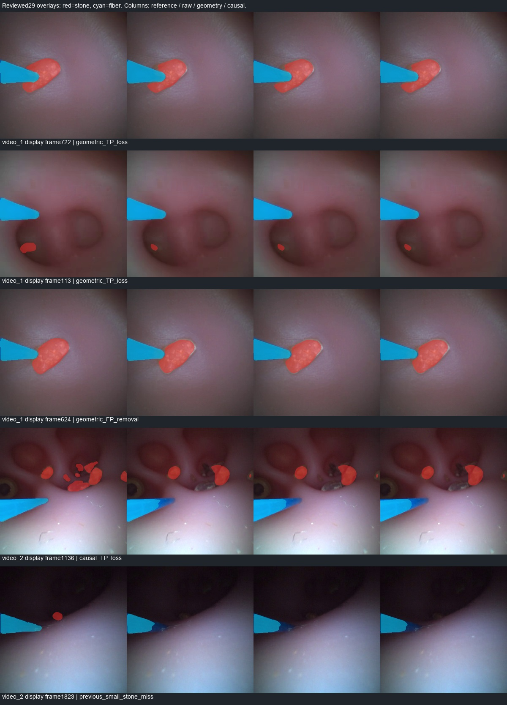

# 光纤几何先验与因果参数跟踪对照

2026-10-28，按用户对几何先验路线的授权执行。**完成132张图像开发验证和两段视频全部2694帧。当前整轮廓几何修正版未通过光纤门槛，不替换默认输出。** 几何减少了一部分误检，但裁掉更多正确光纤，因果参数跟踪未能补回这些损失；CPU成本也明显增加。这个结果针对本轮具体模型和规则，不能推断几何先验整体无效。

原计划的A0单光纤成员两网成本消融已因本次用户授权调整而暂缓，未实现或执行。当前仍未验收S2，未启动结石运动/对象记忆或实例管理；光纤参数跟踪只是本轮独立几何对照。

## 本轮实际实现

[执行前冻结配置](../../configs/fiber_geometry_prior_20261028.json)和[实现](../../tools/fiber_shape_prior.py)均保留。使用同一旧190结石单网+A0光纤双网，共3个U-Net、73,804,185参数，不训练、不改变权重和原始标签。

1. 从当前网络光纤候选寻找靠近估计有效视野边缘的连通区域；不固定必须从左侧进入，也不使用固定蓝色阈值。
2. 在原图彩色梯度上分段寻找两侧边缘，以鲁棒拟合得到两条近似直线；要求足够双侧支持、合理正宽度和线性残差。
3. 在网络候选末端附近拟合半椭圆端帽，检查图像边缘支持。两边延长线交点不用作尖端；这里是二维外观模型，不是标定后的真实锥体。
4. 静态方案将当前几何轮廓与当前光纤概率支持相交，接受区域的阈值固定为0.35；候选还可保留原网络光纤像素。未通过拟合时保留完整原始光纤结果。
5. 因果方案用常速度alpha-beta滤波跟踪入口、方向、长度、两端宽度和端帽比例。只读当前及过去帧；每段视频清空状态，快速变化触发重置。
6. 失去可靠观测时最多保留3帧几何预测，只导出推测参数，**不把历史轮廓填成当前可见光纤**；随后清空。该机制记录预测年龄，没有经过校准的概率或不确定性区间。

两种光纤输出都与同一旧190结石掩膜重新组合，光纤优先。几何变窄可能把旧190结石预测重新露出，因此同时评价结石误差，不能只看光纤轮廓是否规整。

## 原图29帧分割结果

| 方案 | 结石Dice | 光纤Dice | 光纤Precision | 光纤Recall | 光纤边界F，3像素 |
|---|---:|---:|---:|---:|---:|
| 原classwise | 0.8106 | 0.9668 | 0.9890 | 0.9455 | 0.9171 |
| 几何轮廓修正 | 0.8102 | 0.9553 | 0.9921 | 0.9212 | 0.9132 |
| 几何＋因果跟踪 | 0.8102 | 0.9556 | 0.9921 | 0.9217 | 0.9158 |

冻结的光纤Dice门槛为0.9568022，两个新方案都未通过。结石Dice及负帧误检门槛通过，9张无结石帧仍有1张误检，误检面积477/1,440,000=0.033125%。不降低门槛，不在看到结果后调整形状参数。

相对原classwise，静态几何光纤TP净减少4345、FP净减少557；具体为丢失4795个原正确像素、补回450个正确像素，新增292个错误像素、移除849个错误像素。因果方案TP净减少4269、FP净减少558。两者结石TP均不变，但结石FP增加86，体现了光纤裁剪与结石优先关系的相互影响。

事后按拟合轴向三等分定位误差（仅诊断，不是尖端/杆体真值，也不用来回调参数）：静态几何TP损失的4795像素中，入口侧2007、中段1165、末端1623；对应补回46/88/316。因此问题不只在端帽，完整直线模板也会裁掉原本正确的入口和杆体边缘。相对静态几何，跟踪另丢352个TP、补回428个，净补76，不能抵消整轮廓裁剪损失。[逐帧及区域分解](../../runs/a1_fiber_geometry_20261028/error_breakdown.json)

原图可见结石面积≤1024像素仅3帧，各方案均2/3帧有TP、像素召回0.7421。video_2显示帧1823的625像素结石仍完全漏掉；光纤几何没有增加结石记忆能力。

## 几何准入与数据差异

| 材料 | 当前帧拟合接受数 | 主要限制 |
|---|---:|---|
| video_1 | 722/722 | 图像边缘能支持拟合，不代表模板像素正确 |
| video_2 | 1235/1972 | 宽度族不符543帧、直线残差120帧、双侧边缘不足69帧等 |
| 图像开发集 | 10/132 | 入口附近无候选88张、宽度族不符23张、杆体太短8张等 |

视频2有74帧处于仅预测几何、不应用到掩膜的状态，18次到期清空，8次观测跳变重置；未将该视频状态带到另一病例。视频1状态初始化1次、更新721次。所有2694帧原A0、旧190和classwise预测与上轮完整回放逐像素一致，29张审核RGB也精确对齐。

只看29帧中拟合通过的27帧，光纤Dice为原始0.9707→静态0.9578→因果0.9581；这不能代替完整29帧的0.9668→0.9553→0.9556，更不能凭条件子集分数通过全体门槛。[条件评价](../../runs/a1_fiber_geometry_20261028/conditional_evaluation.json)

图像132的结石/光纤Dice为0.9067/0.7623→0.9067/0.7679；只有10张应用修正，其余回退。10张条件子集的光纤Dice为0.8975→0.9223；全体光纤TP净减少600、FP净减少2972。图像来源标签仍待审，没有确认无结石负帧。

| 图像分组 | 原始结石/光纤Dice | 几何结石/光纤Dice |
|---|---:|---:|
| 历史190曝光25组 | 0.9068 / 0.6407 | 0.9068 / 0.6476 |
| 未匹配该曝光107组 | 0.9067 / 0.7945 | 0.9067 / 0.7998 |
| v1来源 | 0.8924 / 0.7970 | 0.8927 / 0.8104 |
| v2来源 | 0.9104 / 0.7443 | 0.9103 / 0.7464 |

A0来源不明，107组也不代表独立病例测试。没有把无序图像送入跟踪器，也没有利用图像或验证视频更新模型。

## 时间变化与成本

未经运动补偿的平均相邻标签变化，视频1为0.1527%→0.1597%→0.1510%，视频2为0.8728%→0.8613%→0.8490%。变化幅度小，不是有真值的稳定性提升。结石有→无次数仍为视频1的7次、视频2的35次；用户遮挡区间的3帧空结石预测未解决。尖端和方向缺少专门参考，不能评价尖端误差、角度准确率或激光物理落点。

本轮采用同帧共享三网前向，另外记录每种方案实际需要的CPU阶段。每帧“派生成本”由本帧核心＋拟合/FOV＋相应光纤输出/融合耗时相加，再统计分位数；不是相加几个p95，也不是独立新进程或实时显示的延迟。实际回放还执行所有对照分支、缓存核对、诊断和导出，不能当作单方案运行速度。

| 成本 | video_1中位 / p95 | video_2中位 / p95 |
|---|---:|---:|
| 原始三网核心，含当前概率CPU传输 | 20.97 / 39.60 ms | 20.42 / 37.50 ms |
| FOV与拟合 | 14.65 / 16.84 ms | 14.28 / 16.37 ms |
| 静态几何派生成本 | 43.47 / 63.37 ms | 39.63 / 59.61 ms |
| 因果几何派生成本 | 43.48 / 63.66 ms | 39.56 / 59.49 ms |
| 实际所有分支回放周期 | 66.63 / 87.18 ms | 60.16 / 81.41 ms |

所有分支含导出的离线吞吐14.50/16.57fps。当前实现仍运行3个网络，并没有通过几何减少网络数；加上约14–15ms平均拟合和整图栅格化开销，不满足实时目标。与前几轮输入/CPU传输及审计负载不同，应看本轮配对增量，不能把跨轮尾延迟变化都归因于几何模型。

## 检查、交付与后续决定

新增3项测试通过：已知合成杆体/末端和游离亮斑、无边缘证据拒绝拟合、因果前缀一致/预测不应用/到期与病例清空。独立复算30项执行核验通过：161张验证输入身份、所有8082张视频预测的类别及几何约束、回退无强制填充、原始预测复现、29帧及132图像混淆矩阵、25/107曝光分组、逐帧改动、成本代数及分位数、视频编码和5段用户区间。[核验结果](../../runs/engineering/fiber_geometry_checks_20261028.json)

- [完整结果](../../runs/a1_fiber_geometry_20261028/summary.json)
- [video_1四栏对照](../../runs/a1_fiber_geometry_20261028/video_1/comparison.mp4)、[video_2四栏对照](../../runs/a1_fiber_geometry_20261028/video_2/comparison.mp4)
- [330–722帧遮挡片段](../../runs/a1_fiber_geometry_20261028/video_1/clips/04_fiber_occlusion_reported_330-722.mp4)
- [代表帧选择依据](../../runs/a1_fiber_geometry_20261028/reviewed_examples.json)

下一步按[准备协议](../../configs/fiber_geometry_component_gate_20261028.json)测试**几何只筛除游离候选、保留受支持主干的全部原始像素**，避免把正确主干裁成理想轮廓。同时把同一筛选思路应用到旧190自身的光纤候选，对照是否有机会以单网获得足够质量；该机会尚未验证，不预告成功或速度。已冻结的形状准入条件不因本轮结果放宽，两个来源都保留原始对照、失败回退及TP损失检查。新协议尚未实现/执行，不自动训练、采用、扫阈值或进入结石记忆阶段。

本轮零训练，stone_new未参与任何训练；video_1/video_2及派生数据仅验证。原始文件、A0/旧190权重、联合521/132/144组、原29帧及来源待审状态均保留。
