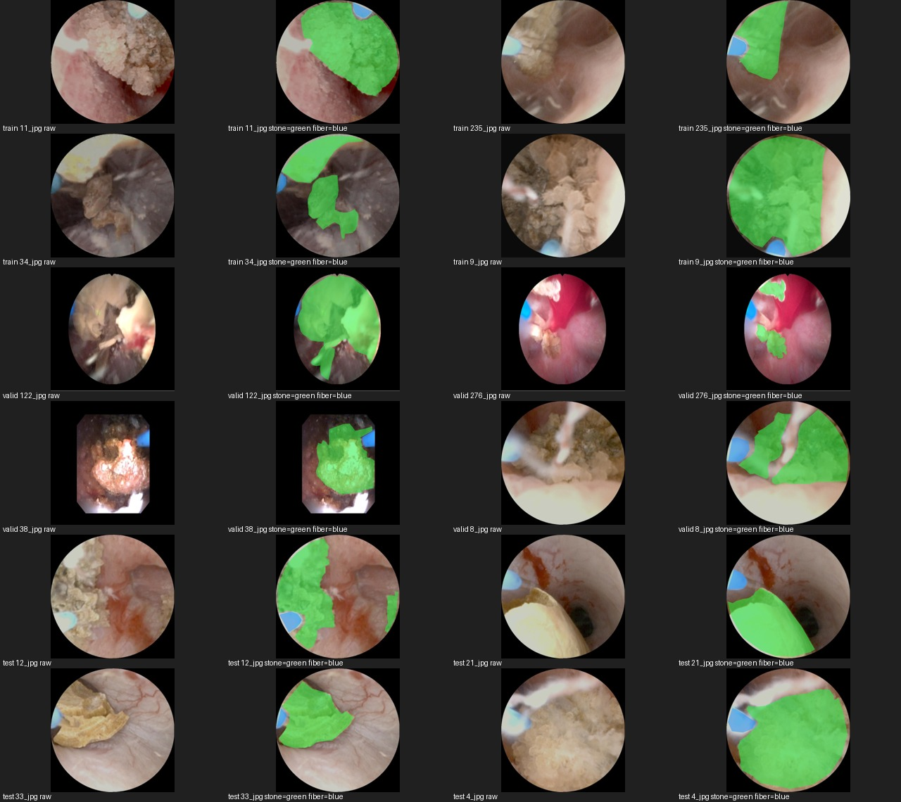
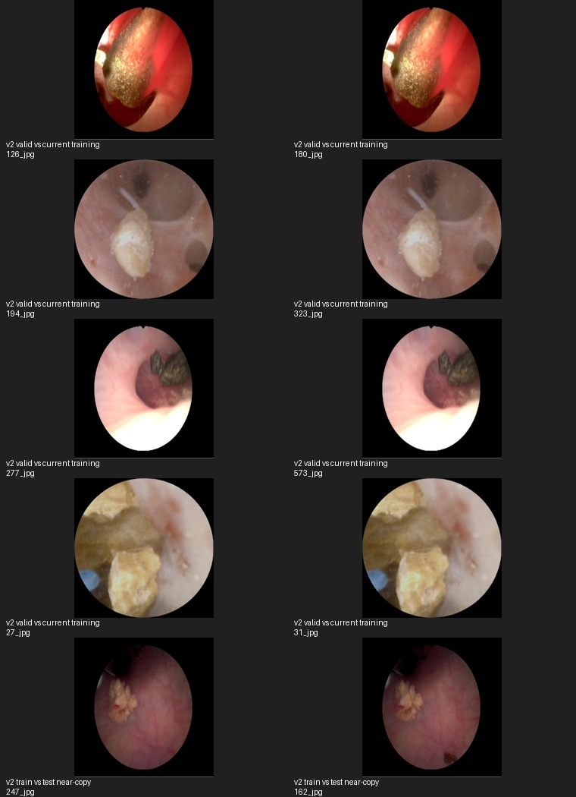

# kidney v2 数据能否用于训练和验证

2026-10-28。**可以作为新一轮监督训练及开发验证的候选来源，但不能将现有目录直接追加到当前训练/验证划分。** v2已有合适的分割类别及多边形标签，同时存在与旧训练图像的近重复以及原训练/测试划分之间的近重复候选。病例独立性未知。

本次只读检查原始数据，未启动训练，未修改活动清单、原始标签、训练/验证视频用途或当前计划的验收状态。

## 数据与标注

目录：`data/Kidney stones-fiber-.v2i.yolov8`。它是本地另一个Roboflow项目导出，与当前v1来源目录不同，不能仅凭名称的v1/v2认定为同一项目的版本升级。

| 原划分 | 图像数 | 文件名原图族数 | 有光纤标注图像 | 有结石标注图像 |
|---|---:|---:|---:|---:|
| train | 798 | 266 | 282 | 798 |
| valid | 89 | 89 | 27 | 89 |
| test | 89 | 89 | 31 | 89 |
| 合计 | 976 | 444 | 340 | 976 |

798张训练图像为266个文件名族，每族3张，与本地说明的增强导出一致；不能当成798个独立原始场景。全部为640×640，说明文件注明由原图拉伸而来，不能将其当成原生640细节或直接用于物理尺寸标定。

976份标签均成功按多边形解析、类别与坐标范围检查通过，没有缺少配对标签。抽查12个不同文件名族的叠加图可见对可见光纤段的区域标注，具备语义分割使用基础；这不是整库标注完整性审核，也不自动确认未标注光纤的图像是真实光纤负例。

必须按类别名重新映射，不能沿用v1数字ID：

| v2类别ID/名称 | 项目三分类ID/语义 |
|---|---|
| 0 fiber | 2 光纤 |
| 1 stone | 1 结石 |
| 2 tissue | 0 背景；保留组织原始辅助层 |

v1的stone为ID2，而v2的ID2是tissue。直接拼接数字标签会把组织误作结石。来源未覆盖区域的背景仍是暂定监督，不能升级为已审核完整背景。

所有976张都有结石标注，没有已标注的无结石负帧。因此它有助于扩充结石和光纤形态，但不能单独解决腔壁误检需要的真实无结石场景覆盖。

## 重复与划分风险

与v1全部1411张图像比较：没有文件字节SHA256完全相同的图像，但发现362张v2图像、涉及233个v2文件名族，与v1存在保守近重复候选。重编码、亮度变化或增强会改变文件哈希，不能只用SHA256去重。上述数字不是新增独立病例数。

关键风险：

- v2 valid有8张与当前190张监督训练图像直接高度近似。抽样并排查看可见同一画面被重新编号和编码。
- 进一步将同一版本的增强文件名族与近重复连成保守分组，valid中16张落在包含当前训练图像的分组；test中14张。分组仅用于降低泄漏风险，不表示核实了病例身份。
- v2内部发现2对train/test近重复候选，涉及train的247_jpg族和test的162_jpg族。虽然不同文件名族没有直接跨原划分，仍不能证明原划分无泄漏。
- 对video_1/video_2全部2694帧顺序解码检查，在本次阈值下未发现近重复候选；这不证明病例独立。两段视频继续全部仅验证。
- 与已排除stone_new图像SHA256清单无精确匹配；其训练禁用规则继续有效。

近重复使用中心80%图像、63位pHash汉明距离≤4，检查8种翻转/90度旋转，并用RGB差异或灰度相关性进一步筛选；其召回并不完整。边界附近帧、相似手术场景和同病例不同帧仍可能漏掉，故不能把未检出重复的剩余部分直接称为独立验证集。

## 建议接入方式

1. 建立新版本来源清单，统一类别名映射和标注依据；保留v2组织层及原始标签，不覆盖当前数据。
2. v1和v2联合按已知病例/视频身份、增强族及精确/近重复候选分组，同组只能出现在一种用途。病例不明继续记待核实，不要求重复人工审核才能做开发实验。
3. 从分组后互斥部分形成新的监督训练与开发验证清单。不得把v2 valid里上述重叠分组用于评价现有模型的泛化；v1的800张备用图像也必须参与用途排除，防止后续扩训练时污染验证。
4. 两段验证视频及派生内容继续禁止训练；保留原29帧作固定开发回归集。v2原test先保持保留，处理近重复后才能讨论其评价用途，来源未知时不称为独立最终测试。
5. 数据或划分改变后，新建实验并从干净初始化重建同预算U-Net监督基线。历史190张数据结果保留，不能把换数据带来的收益称为结构或时序方法的收益。

当前最合适的用途是**扩充监督训练候选、增加图像级开发验证**；不能提供连续视频、跨帧实例身份、遮挡恢复、光纤尖端/方向及激光落点真值。仅“加入数据”不会完成这些能力。

## 产物

- [数据统计](../../runs/data_audit/kidney_v2_20261028/summary.json)、[逐图清单及输入哈希](../../runs/data_audit/kidney_v2_20261028/source_inventory.json)。
- [近重复候选](../../runs/data_audit/kidney_v2_20261028/duplicate_candidates.json)、[保守分组关联](../../runs/data_audit/kidney_v2_20261028/family_overlap_components.json)。
- [检查协议](../../runs/data_audit/kidney_v2_20261028/protocol.json)、[检查工具](../../tools/audit_kidney_v2.py)。

本次只完成准入分析，数据尚未加入活动训练或验证清单。
