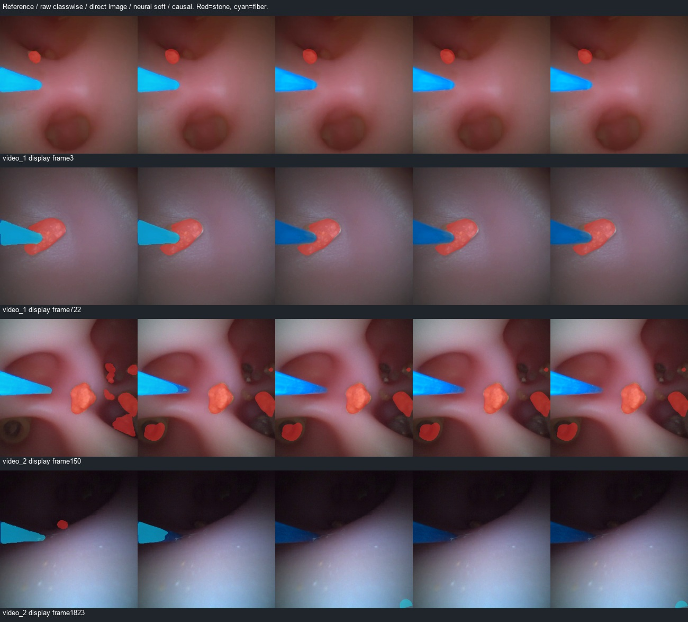

# 唯一光纤固定形状族的直接定位对照

2026-10-29。按用户新授权，实施固定形状族直接全图定位，并比较纯图像、网络软证据和因果姿态选择。**已完成132张图像及两段视频2694帧，但当前三个几何分支在29帧审核集上的光纤Dice均为0，全部失败，不采用。** 失败分解指向本版引入的颜色观测/硬门控不适配验证光纤，不能据此认定固定形状先验本身无效。

本轮没有梯度或神经网络权重训练；确实使用训练数据进行了形状/颜色统计标定，不应把它说成完全不依赖训练数据。默认模型、原权重、标签和521/132/144/29划分均未改变；stone_new及视频派生数据未进入标定或训练。保留test像素未读取，训练来源标签及病例关系仍待核实。

## 实现与训练专用标定

[冻结配置](../../configs/direct_fiber_template_20261029.json)、[实现](../../tools/direct_fiber_template.py)、[训练标定记录](../../runs/a1_direct_fiber_template_20261029/calibration.json)保留。

- 一个物体模型由两条长直边与固定圆形半端帽构成。共享锥角、末端半径不在验证帧自由拟合；每帧只估入口xy、方向和伸出长度。不从CNN最大连通区域提取入口，也不把两边交点当作尖端。
- 仅检查当前521张训练图像和来源掩膜，其中31张满足执行前规定的入口、长度、长宽比和轮廓条件。按合格图像估计共享半宽斜率中位0.1760、完整锥角约19.97°、末端半径/图像短边0.04547；在400图像上相当于半径约18.19像素。
- 斜率四分位为0.1246/0.1760/0.1994，归一化半径为0.04161/0.04547/0.04996。它是混合来源的暂定二维统计模型，不是同一设备、工作通道和光纤的物理标定。
- 用这31张训练图像的光纤与邻域统计HS颜色分布，得到固定前景支持场。验证只估当前帧姿态和因果状态，不更新该分布或共享形状。
- 全图在估计视野边界取64个入口，组合方向、长度形成7040个粗姿态，再局部细化。候选依据内部前景支持、内外差异、边界差异与原图RGB梯度评分。
- 纯图像分支不读取光纤网络概率；软证据分支额外用冻结A0概率为姿态打分。因果分支只使用过去姿态作有界预测约束，每病例清空。神经网络不决定候选组件，也不改变共享形状。
- 接受时只允许一个完整几何假设；可见掩膜另外与当前颜色支持≥0.5相交，三个几何分支使用相同可见性规则。拒绝时光纤为空，不回退A0以掩盖定位失败。历史推测最多3帧且不填充成当前可见光纤；一个实体的可见片段可以不连通。

仓库[camera_parameters.txt](../../camera_parameters.txt)明确标为Godot仿真相机参数，尚无依据将它直接当作本轮两段视频的设备标定，本轮未套用它进行去畸变或物理投影。

## 主要验证结果

所有输出与相同旧190结石组合、光纤优先，原图概率先映射再argmax，审核GT不缩放。

| 方案 | 视频29结石Dice | 视频29光纤Dice | 光纤TP / FP / FN | 图像132光纤Dice |
|---|---:|---:|---:|---:|
| 原classwise | 0.8106 | 0.9668 | 168925 / 1873 / 9728 | 0.7623 |
| 纯图像直接模板 | 0.8100 | **0.0000** | 0 / 2563 / 178653 | 0.3651 |
| 网络软证据直接模板 | 0.8100 | **0.0000** | 0 / 0 / 178653 | 0.4550 |
| 因果姿态直接模板 | 0.8100 | **0.0000** | 0 / 553 / 178653 | 不在无序图像上运行 |

三个分支均未通过原光纤Dice门槛0.9568022。29帧中仅纯图像3帧、软证据0帧、因果1帧检查通过，产生的光纤预测也没有正确覆盖参考光纤；不能仅用拒绝率解释为保守可靠。结石无结石负帧误检仍477/1,440,000=0.033125%，小结石组仍3帧中漏掉1帧。此实验没有解决结石记忆或遮挡问题。

| 全视频 | 纯图像接受 | 软证据接受 | 因果接受 |
|---|---:|---:|---:|
| video_1，722帧 | 9 | 1 | 2 |
| video_2，1972帧 | 383 | 119 | 216 |

因果历史仅推测、未应用到可见掩膜的帧为3/84帧，分别到期清空1/21次。两个视频结束都清空状态。没有稠密事件或尖端/方向真值，以上不是追踪准确率、遮挡恢复率或尖端精度。

图像开发集纯图像/软证据分别26/132、29/132检查通过；25个历史旧190曝光组光纤Dice分别为0.5537/0.5143，107个未匹配该曝光组为0.3271/0.4427。来源标签待审、A0来源未知，不能声称病例独立或将条件通过图像代替全体结果。

## 失败定位：当前颜色门控使几何无法发挥作用

[事后诊断](../../runs/a1_direct_fiber_template_20261029/failure_diagnosis.json)不改变共享形状、参数或主要输出，也不把参考信息送回自动算法。

1. 冻结颜色规则只支持29帧参考光纤像素的**9.6114%**。由于可见掩膜必须落在该支持场内，即使位置完全已知，Recall也不可能超过该值；在没有任何FP的理想情况下，全局Dice理论上限也只有约0.1754。这个上限针对当前颜色支持规则，不是几何形状族的上限。
2. 为区分定位错误与形状表达能力，用参考光纤掩膜PCA给出一个近似参考姿态，将**同一冻结模板**放在该处，得到逐帧平均完整模板Dice约**0.9182**；再套当前颜色支持后仅约0.1470。这个参考条件诊断不是自动结果，也不是经过全局优化的形状上界，不能与主要全局像素Dice混比或当作尖端参考。
3. 对纯图像细搜索，29帧中25帧没有满足全部准入的候选；另1帧存在有效候选但最高分候选被拒绝。后者说明排序与约束顺序也有改善空间，但数量不足以解释主要失败。本轮未据此修改排序或放宽阈值。

因此，本轮失败首先是观测设计失败：把训练来源的颜色统计当作硬门控，抑制了验证画面的实际光纤；网络虽然参与了姿态软评分，仍无法越过这个颜色门控。形状族的准确度、设备适配和搜索质量还需单独验证，不能因为它是单一物体就保证像素正确。

## 成本、检查与交付

独立进程对四组分别测量，预热12帧，video_1前29个连续帧缓存后重复3遍，共87个样本；每遍清空因果状态。不是利用29个稀疏审核帧模拟连续运动。包含实际需要的网络、PIL输入、原图输出、直接搜索和融合；排除解码、显示和导出。

| 方案 | 结石网络＋光纤网络数 | 中位 / p95 |
|---|---:|---:|
| 原classwise | 1＋2 | 16.16 / 19.72 ms |
| 纯图像模板 | 1＋0 | 57.36 / 65.42 ms |
| 软证据模板 | 1＋2 | 64.75 / 70.42 ms |
| 因果模板 | 1＋2 | 64.70 / 74.36 ms |

当前粗搜索本身成本较高，不能凭自由度少或光纤网络数减少宣称加速。完整研发回放共享三网并运行全部对照，另含四套掩膜和五栏视频导出，离线吞吐8.55/8.44fps；这些总耗时不是某一个分支的单独速度，也不是实时显示测试。

3项新增测试通过：独立合成形状直接定位、纯图像分支不受神经概率和历史影响、无光纤/无视野及历史到期不强制填充。31项执行核验通过，覆盖训练专用标定文件/中位参数、固定模板和颜色支持的逐像素重建、2694帧四套输出、原始预测与29审核RGB精确对齐、病例清空、原图混淆矩阵、25/107组和四个独立性能进程的真实1/3网成本。[核验结果](../../runs/engineering/direct_fiber_template_checks_20261029.json)

- [完整结果](../../runs/a1_direct_fiber_template_20261029/summary.json)
- [固定模板及统计](../../runs/a1_direct_fiber_template_20261029/template.json)
- [video_1五栏对照](../../runs/a1_direct_fiber_template_20261029/video_1/comparison.mp4)、[video_2五栏对照](../../runs/a1_direct_fiber_template_20261029/video_2/comparison.mp4)
- [330–722帧片段](../../runs/a1_direct_fiber_template_20261029/video_1/clips/04_fiber_occlusion_reported_330-722.mp4)

**本轮不采用，不把失败概括为几何先验无效。** 下一步按[观测通道对照准备协议](../../configs/direct_template_neural_observation_20261029.json)固定同一个共享形状、搜索和准入阈值，只将颜色前景场替换为冻结A0连续光纤概率，原图梯度校验保持；不重复计入原额外软分数。先做29帧/132图像静态对照，通过原门槛才允许完整因果回放。新协议未实现或执行，不放宽阈值、不从验证标签学习模板或新增神经训练。
