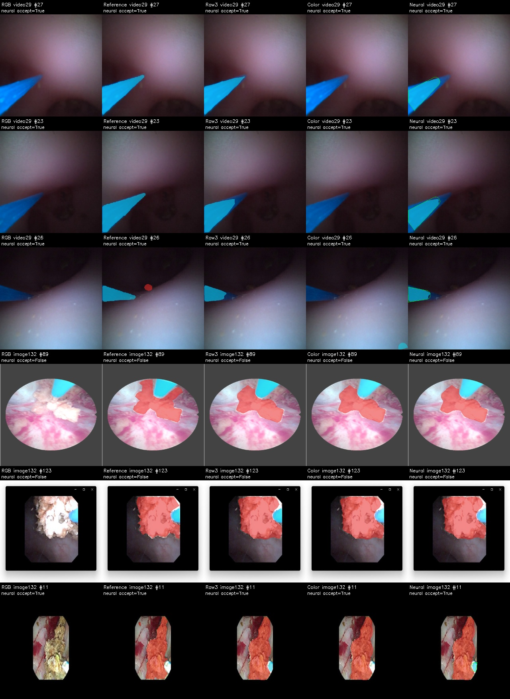

# 固定光纤模板：观测通道单因素对照

2026-10-29。已完成132张图像开发验证、29帧视频像素验证和三个独立进程的耗时对照。**A0连续概率解决了上一轮颜色观测严重失配，但当前模板与自动姿态定位仍损失过多真实光纤，质量和耗时均不支持采用。** 静态候选未过原门槛，按执行前约定停止，没有开展本轮2694帧因果回放。S2未验收，结石记忆未启动。

## 实际执行与固定条件

- [原准备协议](../../configs/direct_template_neural_observation_20261029.json)及[执行配置](../../configs/run_direct_neural_observation_20261029.json)均在本轮验证前冻结。原文件保持历史状态，实际完成状态由本轮job和summary记录。
- 复用[上一轮模板](../../runs/a1_direct_fiber_template_20261029/template.json)：共享斜率0.1760189349、端帽半径/图像短边0.0454693373、圆形端帽。它们来自上一轮521张TRAIN中的31张合格样本，本轮未重新读取训练像素或学习共享统计。
- 唯一变化为前景观测场：TRAIN颜色后验替换为冻结A0的原图光纤概率；评分、候选接受及当前可见支持均使用这一替换。RGB梯度、视野估计、入口/角度/长度搜索、所有阈值与最高分后检查的选择顺序不变；没有叠加旧`network_soft`奖励。
- 可见光纤=已接受的固定模板∩当前前景概率≥0.5∩亮度V>10。一个完整假设最多表示一个光纤，可见片段允许不连通；拒绝时输出空光纤，无神经分割回退。结石仍取old190，光纤覆盖优先。
- 对照为原始三网classwise、固定模板颜色场、固定模板A0概率场。颜色场不消费A0概率；其独立计时只运行一张old190网络作结石分割。概率场和原始组合均实际运行old190一网+A0双网。
- 逐张推理，161张原图输出均在加载对应参考掩膜前生成；参考只进入后续评价与归因。权重及推理前后模型状态一致，梯度更新0。

## 29帧视频验证

所有29帧计入全局混淆矩阵，包含任何拒检；下表不是只选择成功帧的成绩。

| 方案 | 结石Dice | 光纤Dice | 光纤Precision / Recall | 光纤TP / FP / FN | 定位接受 |
|---|---:|---:|---:|---:|---:|
| 原始三网组合 | 0.810617 | 0.966802 | 0.989034 / 0.945548 | 168925 / 1873 / 9728 | 不适用 |
| 固定模板＋颜色场 | 0.810040 | 0 | 0 / 0 | 0 / 2563 / 178653 | 3/29 |
| 固定模板＋A0概率场 | 0.810090 | 0.883211 | 0.995284 / 0.793824 | 141819 / 672 / 36834 | 29/29 |

原门槛为结石Dice≥0.474015、光纤Dice≥0.956802、负帧结石误检面积占比≤0.0778222。原始组合通过；新模板概率场通过结石与负帧项，**未通过光纤项**。三组负帧均为477/1440000=0.033125%，9个无结石参考帧中1帧有误检。

相比原始组合，新概率场损失27106个正确光纤像素，减少1201个误检，无新增光纤TP或FP。结石TP仍为66045，但光纤退让恢复了106个结石FP，结石Dice略降。小结石组仍为3帧、2423参考像素、1798 TP、2/3帧有TP；video_2显示帧1823的625像素结石仍未识别。光纤3像素容差边界F从0.917115降至0.587956。

| 病例对应开发视频 | 原始组合光纤Dice | 颜色场 | A0概率场 |
|---|---:|---:|---:|
| video_1 | 0.987655 | 0 | 0.904126 |
| video_2 | 0.926995 | 0 | 0.843646 |

两段视频来自不同病例，但已反复用于开发，不能作为独立最终泛化测试。本轮没有稠密视频误检、闪烁、遮挡恢复率或实例身份成绩。

## 132张图像开发验证

| 方案 | 结石Dice | 光纤Dice | 光纤Precision / Recall | 光纤TP / FP / FN | 定位接受 |
|---|---:|---:|---:|---:|---:|
| 原始组合 | 0.906703 | 0.762334 | 0.638232 / 0.946348 | 105374 / 59729 / 5974 | 不适用 |
| 颜色场 | 0.907242 | 0.365094 | 0.504563 / 0.286031 | 31849 / 31273 / 79499 | 26/132 |
| A0概率场 | 0.907621 | 0.707453 | 0.819836 / 0.622167 | 69277 / 15224 / 42071 | 39/132 |

新概率场减少44505个FP，也损失36097个TP。50张参考含光纤图像仅33张被接受；39个接受结果中6张参考未标光纤。图像来源标注和完整性仍待审，不把这些数字直接解释为真实临床漏检/误检率。132张均有结石标注，没有确认无结石负图像，不能从该集合计算负帧结石误检占比。

| 历史曝光分组 | 张数 | 原始组合光纤Dice | 颜色场 | A0概率场 |
|---|---:|---:|---:|---:|
| old190历史已曝光组 | 25 | 0.640724 | 0.553651 | 0.730353 |
| 未匹配old190曝光组 | 107 | 0.794550 | 0.327139 | 0.700765 |

两个分组完整且互斥。25组的改善不能掩盖107组和全局退化；A0训练来源未知，未匹配old190不等于A0未见。按v1/v2来源的补充分层混淆矩阵见`failure_attribution.json`，不改变原筛选规则。

## 损失归因

以下由已冻结的推理输出和参考事后计算，没有输入定位器、改阈值或重新拟合共享模板。

29帧参考光纤共178653像素。A0概率支持其中168458像素，覆盖94.2934%，显著高于上一轮颜色支持的9.6114%。当前场不支持10195个参考像素；模板与自动姿态定位又裁掉26639个已被概率场支持的参考像素，最终保留141819 TP。**29/29帧都接受，视频损失不能归因于拒检；当前证据也不能单独区分共享形状失配与自动姿态误差。**

132张参考光纤共111348像素，概率支持105051，覆盖94.3448%。其中25980个支持像素因整帧拒绝丢失，9794个因已接受模板裁切丢失。颜色失配已缓解，几何裁切及图像拒检仍限制结果。不能据此声称“几何先验无效”，也不能承诺固定形状保证分割质量。

已实际查看该图。每行从左至右为RGB、参考、原始组合、颜色场、A0概率场；红为结石、青为光纤、绿线为已接受完整模板。视频行可见入口/杆体被裁切；图像行包括整帧拒绝及接受样例。视频参考索引27/23/26分别对应video_2显示帧1898/987/1823；图像索引89/123/11对应本轮固定清单，具体sample_id见核验文件。样例按TP损失与接受状态挑选，只作说明，不替代全161张统计。

## 同轮独立耗时

每组单独进程，固定video_1顺序解码的前29帧，缓存后12次预热，3遍共87次测量；实际执行所有需要的网络。包括预处理、网络、原图传输、定位/栅格化和融合，不含解码、显示、导出，不能视为实时整机验收。

| 方案 | 实际网络数 | 全路径P50 / P95 ms | 几何与融合均值ms |
|---|---:|---:|---:|
| 原始组合 | 3 | 22.105 / 32.737 | 0.001 |
| 颜色场 | 1 | 68.772 / 85.246 | 64.208 |
| A0概率场 | 3 | 101.755 / 137.299 | 77.831 |

本轮概率场方案没有节省网络，当前全局搜索实现又增加成本；不能用共享推理或只统计网络核心宣称加速。计时存在本机运行波动，这里只比较同轮实际样本，未做额外重跑挑最好成绩。

## 核验、文件与决定

7项针对性测试通过：4项新观测通道测试及3项原固定模板测试。独立保存输出核验27项通过，包括原始/颜色分支逐像素及定位记录复现、322个验证文件身份、共享模板/配置不变、独立混淆矩阵及TP/FP变化、25/107分组、三进程实际网络数与耗时分位数、静态失败后无因果回放。没有声称重跑全部项目测试。

- [实际结果](../../runs/a1_direct_neural_observation_20261029/summary.json)、[运行状态](../../runs/a1_direct_neural_observation_20261029/job.json)、[事后归因](../../runs/a1_direct_neural_observation_20261029/failure_attribution.json)、[27项核验](../../runs/engineering/direct_neural_observation_checks_20261029.json)。
- 原图掩膜483张：`image_native`下396张、`video_native`下87张；另存两组完整假设322张和161份原图概率。配置/源码快照、输入及权重哈希、拒绝原因、成功帧条件指标、全部帧指标与成本原始样本均保留。
- 神经梯度更新0，新共享标定0，训练像素读取0，144组保留test像素读取0。521/132/144/29划分、来源待审状态、stone_new训练禁用及video_1/2验证专用约束不变。A0只冻结推理，没有作为新训练初始化。
- **不采用当前模板概率场修正可见分割，不放宽阈值或扩大搜索；没有默认模型替换、结石记忆、S3或物理端点/方向/落点验收。**

下一步恢复既有[A0单光纤成员两网对照](../../configs/compare_two_network_experts_20261028.json)：固定old190结石，分别比较A0 model1/model2光纤与原三网组合的质量及成本，不加入本轮几何掩膜修改。只做这两个预设成员，若均未保留原门槛则停止成员搜索，再进入已计划的光纤专用轻量精修可行性；本记录不表示该下一步已执行。
