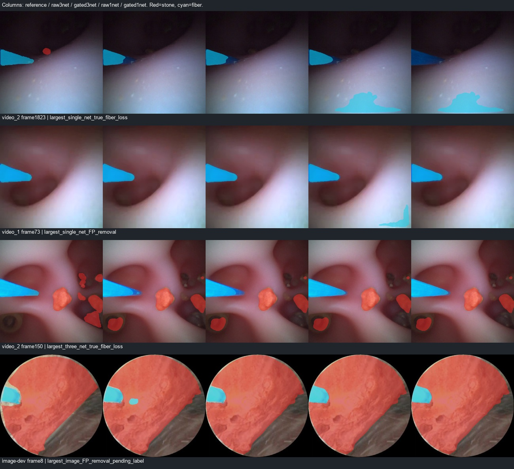

# 光纤几何候选筛选与单网可行性对照

2026-10-29。**四组对照及符合条件的完整2694帧回放已完成。三网筛选通过原开发初筛，但视频精度略降且明显变慢；旧190单网筛选未过光纤门槛。两个筛选方案均不采用。** 本轮保留了受支持组件的全部原始像素，避免了上一版整轮廓裁剪，但仍会误删断开的真实光纤，甚至误选形状相似的腔壁。

本轮没有训练、放宽几何阈值、修改标签/默认模型或启动结石记忆。联合521训练/132图像开发验证/144原test关联组、原29帧视频验证及来源待审状态均保留。stone_new继续禁止所有训练用途，两段视频及其派生结果仅验证，保留test像素未读取。

## 实现与固定口径

按原[准备协议](../../configs/fiber_geometry_component_gate_20261028.json)及[本轮执行配置](../../configs/run_fiber_component_gate_20261029.json)，比较：旧190结石+A0光纤的三网原始/筛选输出，以及旧190自身同时预测两类的单网原始/筛选输出。

入口、双侧原图边缘、直线残差、宽度和末端检查完全沿用前一版`fit_shape`；源码SHA与全部拟合参数在执行前后核对。检查通过时保留同一最大入口邻近连通组件的**每一个原始像素**，仅删除其他光纤组件；不与理想管状模板求交、不补像素、不做闭运算或时序平滑。检查不通过则完整回退原始光纤。输出与同一旧190结石重新组合，光纤优先。

所有方案均为PIL RGB双线性256输入、原归一化、FP32概率映射回原图后argmax，参考掩膜不缩放。四组均评价全部29审核帧与132图像，包含回退；通过原三项门槛的筛选候选再回放完整视频。本轮只有三网筛选满足回放条件，未为单网失败候选额外回放或扫参数。

## 29帧视频分割结果

| 方案 | 网络数 | 结石Dice | 光纤Dice | 光纤Precision | 光纤Recall | 光纤边界F，3像素 |
|---|---:|---:|---:|---:|---:|---:|
| 原classwise | 3 | 0.8106 | 0.9668 | 0.9890 | 0.9455 | 0.9171 |
| classwise候选筛选 | 3 | 0.8106 | 0.9666 | 0.9890 | 0.9451 | 0.9195 |
| 原old190 | 1 | 0.8100 | 0.9038 | 0.8745 | 0.9352 | 0.7059 |
| old190候选筛选 | 1 | 0.8100 | 0.9027 | 0.8944 | 0.9112 | 0.7211 |

三网筛选光纤Dice0.9665834达到固定门槛0.9568022；但达到门槛不代表优于原classwise。单网筛选0.9026956未达门槛。四组负帧结石误检均为477/1,440,000=0.033125%，9帧中1帧有误检。小结石组仅3帧，均2/3帧有TP，像素召回0.7421，已知625像素结石漏检未恢复。

相对于各自原始输出：

- 三网筛选27/29帧检查通过，仅2帧实际发生删除：video_2显示帧150删除46个正确光纤像素，1062删除28个；合计TP损失74，FP减少0，没有新增光纤或改变结石像素。
- 单网筛选27/29帧检查通过，14帧实际删除，光纤TP损失4285、FP减少4744；Recall从0.9352降至0.9112，不能仅因Precision提高就采用。单网结石掩膜按构造保持不变。
- 其中显示帧73去掉3012个FP，也丢掉54个TP；**video_2显示帧1823丢掉3809个TP，只去掉28个FP**。对比图显示底部腔壁误检被选为入口邻近的主组件，而真实左侧光纤被当作另一个组件删除。

本轮入口约束是“靠近估计视野边缘”，没有相机/工作通道的固定入口标定。腔壁误检也可能满足边缘、轮廓和末端拟合条件。因此当前几何准入不足以确认光纤语义，最大组件策略也不足以确认身份；这不否定更充分的入口标定或观测模型，但不能把拟合通过当作正确分割。

只看检查通过的27帧，三网光纤Dice0.9707→0.9705，单网0.9028→0.9015，仍无提升。完整29帧评价始终是主要结果，未通过条件筛选隐藏失败样本。

## 132图像开发验证

| 方案 | 全132结石/光纤Dice | 历史190曝光25组 | 未匹配该曝光107组 |
|---|---:|---:|---:|
| 原classwise | 0.9067 / 0.7623 | 0.9068 / 0.6407 | 0.9067 / 0.7945 |
| classwise筛选 | 0.9068 / 0.7662 | 0.9069 / 0.6440 | 0.9067 / 0.7986 |
| 原old190 | 0.9072 / 0.7825 | 0.9083 / 0.8278 | 0.9070 / 0.7730 |
| old190筛选 | 0.9072 / 0.7825 | 0.9083 / 0.8278 | 0.9070 / 0.7730 |

三网10/132检查通过，4张实际删除，相对来源参考移除1401个光纤FP，没有光纤TP损失；重新露出的旧190结石预测增加1015个TP和366个FP。该10张子集光纤Dice0.8975→0.9126。单网12/132检查通过，但没有发生任何像素变化，不能称为12张获得改善。

图像来源标签仍待审，没有确认无结石负帧。A0来源不明，107个未匹配旧190曝光组也不能证明病例独立；不合并图像与视频得分宣称升级。

## 同轮独立进程成本

RTX4070Ti；每组独立新进程，batch1、预热12帧、29帧×3次共87个样本，缓存原图PIL输入。包含实际所需网络、原图概率和光纤概率CPU传输、启用时的FOV/拟合/筛选及融合；排除解码、导出、显示。单网进程只加载旧190，不借用A0或共享三网前向。

| 方案 | 参数量 | 中位 / p95 | CUDA峰值分配 |
|---|---:|---:|---:|
| 原classwise | 73.80M | 24.53 / 33.37 ms | 319.82 MiB |
| classwise筛选 | 73.80M | 40.41 / 59.09 ms | 319.82 MiB |
| 原old190 | 24.60M | 10.34 / 14.08 ms | 128.77 MiB |
| old190筛选 | 24.60M | 25.59 / 37.86 ms | 128.77 MiB |

筛选本身中位17.90/16.43ms，较原始方案的中位总成本分别增加约15.88/15.25ms（分位数差不等于逐帧开销）。当前实现仍需要原图拟合，单网＋筛选也没有相对原三网显示成本优势，且分割质量明显不足；不据参数量推断速度。

## 三网筛选完整回放

顺序解码video_1的722帧和video_2的1972帧，共2694帧。29张审核RGB精确对齐，原始预测与历史完整回放逐像素一致，重新计算29帧筛选掩膜与初筛逐像素一致。每段预热12帧、相同帧重复结果一致；没有跨帧预测状态。

| 诊断 | video_1 | video_2 |
|---|---:|---:|
| 检查通过 | 722/722 | 1235/1972 |
| 实际删像素的帧 | 6 | 339 |
| 删除光纤预测像素总数 | 2353 | 98692 |
| 筛选管线中位 / p95 | 46.94 / 58.38 ms | 44.79 / 56.43 ms |
| 含解码/诊断/导出的周期中位 / p95 | 62.51 / 76.52 ms | 59.14 / 71.99 ms |
| 含导出的离线吞吐 | 15.61fps | 16.59fps |

这些删除总数不是正确去除误检的数量，未审核帧没有稠密真值。未经运动补偿的相邻标签变化均值为视频1的0.1527%→0.1512%、视频2的0.8728%→0.8514%；变化变小不等于更准确。结石有→无仍为7次和35次，既有遮挡区间的空结石预测未解决。记录到的最大单帧筛选管线耗时约388.63ms，未将其隐藏为平均值；没有实测实时输入队列、显示和丢帧。

## 检查与决定

4项新增测试通过：原主干逐像素保留、拒绝拟合完整回退、断开真实尖端可能被删，以及单网路径不加载A0。26项执行核验通过，包括四组原图混淆矩阵、组件与回退规则、TP/FP变化、25/107曝光分组、四个独立性能进程的实际模型数、完整2694帧掩膜及5段片段、输入/源码/权重身份。[核验结果](../../runs/engineering/fiber_component_gate_checks_20261029.json)

- [完整结果](../../runs/a1_fiber_component_gate_20261029/summary.json)
- [代表帧与选择依据](../../runs/a1_fiber_component_gate_20261029/representative_examples.json)
- [video_1输入/原始/筛选对照](../../runs/a1_fiber_component_gate_20261029/full_replay/classwise_component_gate_3net/video_1/comparison.mp4)
- [video_2输入/原始/筛选对照](../../runs/a1_fiber_component_gate_20261029/full_replay/classwise_component_gate_3net/video_2/comparison.mp4)
- [330–722帧遮挡片段](../../runs/a1_fiber_component_gate_20261029/full_replay/classwise_component_gate_3net/video_1/clips/04_fiber_occlusion_reported_330-722.mp4)

决定：**暂不把这两版几何规则用于修改可见分割掩膜。** 保留代码、失败样本及二维形状推测作独立研究对照，不宣称尖端、方向、物理尺寸或激光落点已验证。没有为几何失败再放宽阈值或扩展搜索。

下一步恢复此前暂缓的[A0单光纤成员两网对照](../../configs/compare_two_network_experts_20261028.json)：旧190结石分别搭配A0的model1/model2光纤，固定两个候选和原融合规则，检查能否保留质量并降低网络成本。该步骤尚未执行；不继续裁剪掩膜、不训练、不自动采用或进入结石记忆阶段。
