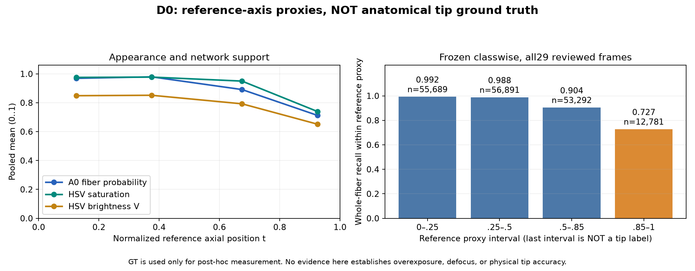

# D0：唯一光纤的网络漏检、历史后处理与远端外观诊断

2026-10-29。已按批准计划完成D0：复现29帧视频参考及132张图像开发集，缓存完整FP32概率，分解历史处理损失，并在两个独立进程中测试video_1/2的全部722/1972帧。**本轮没有新增分割方案、拟合颜色模型或修改可见掩膜；没有训练、共享模板标定、默认替换或结石记忆。**

用户新要求已纳入[执行协议](../../configs/fiber_tip_d0_20261029.json)：以后每个实际进入对照的方案，都必须在两个完整视频上测性能和失败行为，静态未达标也不免测。质量门槛继续控制采用决定，不能把无真值全片的诊断当作准确率。D0只有冻结classwise这一个实际推理方案；历史方案的缓存损失归因、最近邻映射和阈值反事实不是本轮新增候选，也没有借此宣称改善。

## 复现与数据范围

仍使用old190结石单网+A0光纤双网，共3个U-Net、73,804,185参数；256输入、PIL双线性RGB、原归一化、logits集成后softmax、FP32概率双线性映射原图后argmax、光纤优先。静态额外保留A0两个成员的三类概率，未将概率均值替代logits均值。

| 材料 | 结石Dice | 光纤Dice | 光纤TP / FP / FN |
|---|---:|---:|---:|
| 29帧视频参考 | 0.810616754 | 0.966802213 | 168925 / 1873 / 9728 |
| 132张图像开发集 | 0.906703357 | 0.762334012 | 105374 / 59729 / 5974 |

全部161张classwise原图预测与历史缓存逐像素一致。两个完整视频的2694帧也与历史classwise逐像素一致，29个审核时点RGB精确对齐。静态与完整推理前后权重状态均未变。

本轮只读取322个验证图像/掩膜文件及既有实验数据，TRAIN像素读取0、144个保留test关联组像素读取0。521/132/144/29划分、来源待审状态及stone_new训练禁用不变。29帧和132图像均为已参与开发的材料，不是独立最终测试。

## 网络原始漏检

以下均相对当前参考可见光纤计算，尚未使用任何尖端专属标注。

| 归因 | 视频29 | 图像132 |
|---|---:|---:|
| 原始光纤FN | 9728 | 5974 |
| FN中背景胜出 | 9719 | 5478 |
| FN中结石胜出 | 9 | 496 |
| FN中光纤概率<0.1 | 5756 | 3763 |
| FN中光纤概率[0.1,0.5) | 3972 | 2211 |
| FN中至少一个A0成员仍判光纤 | 2941 | 1629 |
| FN中两个成员均不判光纤 | 6787 | 4345 |

视频约59.2%的原FN在网络输出中已经低于0.1。这些像素并非被后续几何删除，也不能靠“保留高置信像素”自动找回。9719个FN竞争背景，只有9个竞争结石，不能把视频漏检主要归咎于old190结石覆盖。classwise融合按构造保留A0类别为光纤的每个像素。

成员分歧说明部分漏检与集成有关，但本轮没有比较单成员方案的整体精度或成本，更未据此替换成员。所有概率分箱均为执行前冻结的描述性统计，不是新推理阈值。

在相同PIL输入上，将模型网格argmax后最近邻放大作为反事实，视频可新增2213个原漏检TP，也会删除257个原TP；图像新增304、删除552。它仅说明映射顺序会改变结果，既不是默认OpenCV演示的完整复现，也没有评价其全部FP，因此不能认定最近邻更好。若以后将它提升为候选，仍须另行冻结协议并按用户要求测试两个完整视频。

## 历史后处理的首次排除位置

对固定模板，按“候选被拒绝→模板之外→前景支持不足→暗部门控”固定顺序作互斥计数；各项合计严格等于删除的原TP。交集各条件本可重叠，计数顺序不应解释为独立因果效应。

| 视频29方案 | 定位拒绝 | 模板之外 | 随后前景门控 | 随后暗部门控 | 删除原TP合计 |
|---|---:|---:|---:|---:|---:|
| 固定模板＋颜色场 | 153140 | 15785 | 0 | 0 | 168925 |
| 固定模板＋A0概率 | 0 | 26958 | 148 | 0 | 27106 |

颜色场在评分/准入时已拒绝大部分帧，剩余原正确像素也落在错误模板外。因此“最终颜色门控新增删除0”不表示颜色可靠；上一轮9.6114%参考支持覆盖的证据仍成立。

概率模板29/29帧接受，但当前几何/姿态排除造成26958个原TP损失，随后0.5门控再删除148个。若脱离模板单独应用0.5门控，会删除467个原TP；其中319个已被前面的几何排除计入，不能重复相加。暗部V≤10没有进一步删除视频原TP，不能将本次视频退化主要归咎于该暗部门槛。

图像132概率模板删除36097个原TP：26088来自整帧拒绝，9938来自模板外，68来自随后概率门控，3来自暗部。其与视频的主要瓶颈不同，应分别报告。

整轮廓修正、因果修正、三网/单网组件筛选，以及颜色/软评分/因果模板的TP/FP变化也已按全部参考样本重新汇总，见`diagnosis_summary.json`。这些只是冻结输出的归因，不重新估计几何或放宽历史阈值。

## 远端代理区域与外观

尚无独立的杆体/尖端标签。本轮PCA使用所有参考光纤像素，不取最大组件，按估计视野边缘距离确定方向；几何不够细长或方向歧义时跳过轴向统计。该参考轴线只进入事后测量，完全不进入推理。

视频29帧均满足代理轴线条件；图像132中仅11张满足，另82张没有足够参考光纤、26张不够细长、13张方向有歧义。因此图像的轴向统计仅代表11张子集，不能代替全132张结果。

| 视频参考轴向区间 | 参考像素 | 原始FN | 光纤Recall | 平均光纤概率 | 平均饱和度S | 平均亮度V |
|---|---:|---:|---:|---:|---:|---:|
| t∈[0,.25) | 55689 | 433 | 0.992225 | 0.9691 | 0.9754 | 0.8488 |
| t∈[.25,.5) | 56891 | 708 | 0.987555 | 0.9794 | 0.9777 | 0.8518 |
| t∈[.5,.85) | 53292 | 5104 | 0.904226 | 0.8914 | 0.9499 | 0.7927 |
| t∈[.85,1] | 12781 | 3483 | 0.727486 | 0.7128 | 0.7397 | 0.6519 |

最远端15%的参考轴向代理区更难，且其平均S和V均较低。**这不是尖端Recall，也不能证明真实尖端主要变白、过曝或失焦。** RGB/HSV/Lab、归一化色度、局部亮度残差、彩色梯度及法向梯度的逐帧/池化分布均已保存，未训练颜色判别器。

视频低饱和S<0.2的333个参考像素Recall约0.2703，困难确实存在；但7554个FN仍来自S≥0.5的区域，约占全部FN的77.6%。因此只修低饱和颜色不足以覆盖大部分漏检。V≥0.98的58224个参考像素Recall约0.9955，不能据当前材料预先认定“高亮/过曝是主要漏检原因”；高V也不等于经标定的过曝标签。

图像开发集S<0.2有27247个参考像素，Recall约0.9231，与视频分布明显不同。这进一步提示不能把少量训练来源的统一HS表硬套为可见性门控，但尚不能将其差异归结为某一个物理因素。

已查看两张12帧试点联系表，包含原RGB、整帧参考、A0概率、classwise、FN/FP及轴向代理区。video_2显示帧150、987、1062、1823、1898可见远端附近漏检；这仍是相对可见光纤参考的观察，没有自动将这些像素认定为物理尖端。video_1的前方浅白区域部分在原参考中属于结石，也不能把亮块一律填为光纤。

## 两段完整视频性能

每段视频独立新进程、3网、batch1、FP32，12帧预热后从第0帧重新顺序处理全部视频。所有722/1972帧均计入分位数，非29帧采样或挑最快片段。模型、输入及输出身份保留。

| 全片测试 | video_1 | video_2 |
|---|---:|---:|
| 处理帧数 | 722 | 1972 |
| 推理管线P50 / P95 ms | 28.792 / 36.409 | 24.048 / 37.075 |
| 推理管线最大值ms | 42.836 | 47.765 |
| 含解码、渲染、审计、导出周期P50 / P95 ms | 34.164 / 42.240 | 29.326 / 43.005 |
| 含全部导出的离线吞吐fps | 29.627 | 31.955 |
| CUDA峰值分配MiB | 319.819 | 319.819 |
| 相对历史classwise差异像素 | 0 | 0 |

推理管线包含PIL预处理、全部3网、FP32原图概率映射、融合及必要CPU传输；不含参考核对和磁盘导出。全周期另含解码、两栏H.264渲染、历史核对、PNG/日志导出及写入收尾。静态FP32缓存压缩不进入这份完整视频计时。

P95均超过约33.3ms，不能宣称30fps实时验收。离线平均吞吐不代表实时显示、等待队列或丢帧表现。也不能将本轮不同导出负载下的速度与旧实验直接比较，推断网络或算法升级。

## 参考模板、检查与下一步

已生成12帧待审尖端参考模板，每病例6帧，全部端点、ROI和专项掩膜字段保持空；原整帧审核信息仅作上下文，不自动变成尖端审核通过。物理尖端、端面和不可见部分没有生成伪真值，专项指标仍为null。

4项针对性测试、19项独立工程核验通过，覆盖互斥损失守恒、未知像素、断片轴线、BGR/白色/暗部处理、完整概率归一化、原图融合、161张指标、所有2694帧掩膜和时间分位数、两独立进程、29张RGB对齐及H.264完整解码。没有重跑全部项目测试。

源快照原档保留；其中Windows路径分隔符别名产生了内容相同的重复条目，另生成去重的`source_snapshot_canonical.zip`，逐项验证内容哈希一致。该整理不改变算法、输出或原记录。

- [完整结果](../../runs/a1_fiber_tip_d0_20261029/summary.json)、[归因汇总](../../runs/a1_fiber_tip_d0_20261029/diagnosis_summary.json)、[19项核验](../../runs/a1_fiber_tip_d0_20261029/engineering_checks.json)。
- [12帧待审模板](../../runs/a1_fiber_tip_d0_20261029/tip_reference_pilot.template.json)。
- [video_1诊断联系表](../../runs/a1_fiber_tip_d0_20261029/video_1_pilot_diagnostic_board.jpg)、[video_2诊断联系表](../../runs/a1_fiber_tip_d0_20261029/video_2_pilot_diagnostic_board.jpg)。
- [video_1完整基线回放](../../runs/a1_fiber_tip_d0_20261029/full_video/video_1/baseline_replay.mp4)、[video_2完整基线回放](../../runs/a1_fiber_tip_d0_20261029/full_video/video_2/baseline_replay.mp4)。

下一步是D1最小尖端参考确认，进一步分清蓝色包覆杆体末端、浅色端部、相邻结石和未知区域。参考不足时维持代理/定性报告，不强制重审全部训练数据。之后才准备A+冻结对照：保留全部原光纤像素，只作当前图像证据支持的有限补充；本轮没有执行A+或新训练。5756个低概率视频FN也提示其能力可能有限，不能预告会解决全部漏检。

所有以后实际实现的A+/B/C/D候选，都按用户要求运行两个完整视频的质量参考采点与全片性能/失败诊断；静态失败也完整测量，仍不因此通过采用。E训练侧改进继续需要另行计划与用户批准，默认模型不自动更换。
