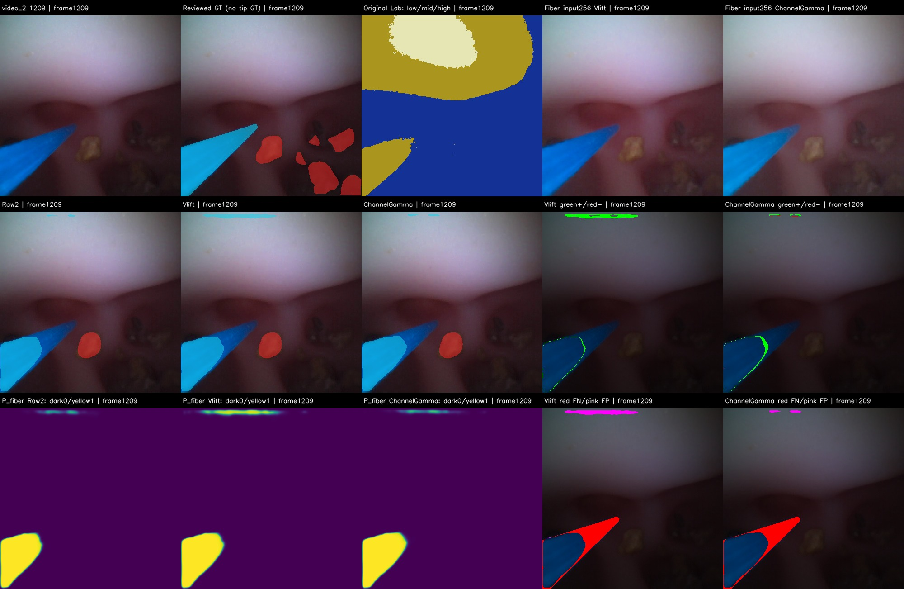

# 暗色光纤：固定输入响应三臂完整对照

2026-10-30。**固定gamma0.7的两个全局光纤输入变换均未通过冻结质量门槛，不采用。** 三臂完成70帧视频参考、132张图像的新推理和两个完整视频，6个独立进程8082正式帧。没有继续扫gamma、改变阈值、训练、修改默认或进入结石记忆。

## 实现与复现

仅新增`tools/fiber_photometric_input.py`、`tools/run_fiber_dark_input_control.py`及机制测试；历史推理代码/权重/配置/标签/划分保持。原图经同一PIL双线性缩为256，float32 RGB在ImageNet归一化之前变换，不回uint8。共同缩放为C/max(C)×max(C)^0.7，黑像素保持0；逐通道为C^0.7。二者最大通道值相同，但Lab亮度与颜色比例不同，不能当纯照明/纯色相因果对照。

原输入共享一份张量；变换臂额外准备并传输一份光纤张量。每帧仅原old190结石与对应A0 model1光纤两个前向，共49,202,790参数；没有多跑原光纤、TTA、原概率取max、几何、历史或GT推理输入。每个静态/完整过程用forward hooks核对实际分支次数。两份三类原图概率和原图掩膜均传回CPU。

606次静态配对帧推理（每次两个分支）全部真实运行，raw2的原图掩膜/概率/指标精确复现。结石概率在全部静态及8082帧对应输出中精确一致；最终结石掩膜仍会受光纤优先覆盖变化。机制测试10项、既有类别分工/单成员回归6项通过；独立工程核验99项通过。合成测试与身份核验不替代实际质量。

## 整体质量

以下为重复开发参考上的语义像素指标；70帧不是2694帧稠密精度，132图像不是独立最终测试。

### 70帧视频参考（43/27）

| 方案 | 结石Dice | 结石Precision | 结石Recall | 光纤Dice | 光纤Precision | 光纤Recall | 光纤边界F |
|---|---:|---:|---:|---:|---:|---:|---:|
| 原输入两网 | 0.740216 | 0.899778 | 0.628722 | 0.945537 | 0.970967 | 0.921404 | 0.862027 |
| RGB共同缩放提亮 | 0.740241 | 0.899852 | 0.628722 | 0.946278 | 0.961446 | 0.931580 | 0.859993 |
| 逐通道Gamma | 0.740211 | 0.899762 | 0.628722 | 0.951919 | 0.974943 | 0.929957 | 0.880803 |

| 方案 | 光纤TP | 光纤FP | 光纤FN | 新增正确TP | 删除原正确TP | 新增FP | 移除FP | 原P≥0.9正确光纤被删 |
|---|---:|---:|---:|---:|---:|---:|---:|---:|
| 原输入两网 | 417783 | 12492 | 35637 | 0 | 0 | 0 | 0 | 0 |
| RGB共同缩放提亮 | 422397 | 16938 | 31023 | 5740 | 1126 | 4990 | 544 | 161 |
| 逐通道Gamma | 421661 | 10837 | 31759 | 5488 | 1610 | 879 | 2534 | 2 |

| 方案 | 结石TP | 结石FP | 结石FN | 结石边界F | 语义光纤骨架覆盖 | 实际改变帧数 |
|---|---:|---:|---:|---:|---:|---:|
| 原输入两网 | 152516 | 16988 | 90065 | 0.475440 | 0.895350 | 0 |
| RGB共同缩放提亮 | 152516 | 16974 | 90065 | 0.475440 | 0.914663 | 70 |
| 逐通道Gamma | 152516 | 16991 | 90065 | 0.475440 | 0.908910 | 70 |

### 132张图像开发集（68/64来源）

| 方案 | 结石Dice | 结石Precision | 结石Recall | 光纤Dice | 光纤Precision | 光纤Recall | 光纤边界F |
|---|---:|---:|---:|---:|---:|---:|---:|
| 原输入两网 | 0.906751 | 0.880212 | 0.934940 | 0.765758 | 0.643433 | 0.945513 | 0.524869 |
| RGB共同缩放提亮 | 0.906793 | 0.880315 | 0.934913 | 0.756289 | 0.625077 | 0.957224 | 0.487527 |
| 逐通道Gamma | 0.906961 | 0.880212 | 0.935387 | 0.770020 | 0.655764 | 0.932491 | 0.503567 |

| 方案 | 光纤TP | 光纤FP | 光纤FN | 新增正确TP | 删除原正确TP | 新增FP | 移除FP | 原P≥0.9正确光纤被删 |
|---|---:|---:|---:|---:|---:|---:|---:|---:|
| 原输入两网 | 105281 | 58343 | 6067 | 0 | 0 | 0 | 0 | 0 |
| RGB共同缩放提亮 | 106585 | 63930 | 4763 | 1354 | 50 | 6309 | 722 | 0 |
| 逐通道Gamma | 103831 | 54505 | 7517 | 259 | 1709 | 2215 | 6053 | 548 |

| 方案 | 结石TP | 结石FP | 结石FN | 结石边界F | 语义光纤骨架覆盖 | 实际改变帧数 |
|---|---:|---:|---:|---:|---:|---:|
| 原输入两网 | 6120805 | 832978 | 425928 | 0.393852 | 0.889670 | 0 |
| RGB共同缩放提亮 | 6120623 | 832143 | 426110 | 0.394493 | 0.904896 | 69 |
| 逐通道Gamma | 6123726 | 833377 | 423007 | 0.393862 | 0.872570 | 69 |

形态学骨架覆盖仅表示参考语义光纤骨架被预测覆盖的比例，允许可见片段不连通；它不是真实物理中心线、杆体长度或尖端坐标。逐帧混淆矩阵、3px边界计数、变化、原29/新增41、两病例、来源及25/107历史曝光分组均保留在静态JSON与CSV。

## 原图亮度分组与主要失败

亮度始终按原RGB的OpenCV Lab L与HSV V编码[0,85,170,256]分组，不用提亮图重分组。该分组是显示图像明暗代理，不是设备照度或照明因果。GT内部距边界超过3×min(H,W)/400像素的统计也在JSON中单列。

| 参考集合 | 方案 | 低Lab组GT | 低Lab组TP | 低Lab组FN | 低Lab组Recall | 中亮组Recall | 高亮组Recall |
|---|---|---:|---:|---:|---:|---:|---:|
| 70视频 | 原输入两网 | 46105 | 28640 | 17465 | 0.621191 | 0.947834 | 0.998710 |
| 70视频 | RGB共同缩放提亮 | 46105 | 31609 | 14496 | 0.685587 | 0.952557 | 0.998826 |
| 70视频 | 逐通道Gamma | 46105 | 31147 | 14958 | 0.675567 | 0.951772 | 0.998793 |
| 132图像 | 原输入两网 | 1211 | 704 | 507 | 0.581338 | 0.947563 | 0.950479 |
| 132图像 | RGB共同缩放提亮 | 1211 | 765 | 446 | 0.631709 | 0.959378 | 0.961505 |
| 132图像 | 逐通道Gamma | 1211 | 722 | 489 | 0.596201 | 0.946929 | 0.930906 |

| 分组 | 方案 | 低Lab组Recall | 中亮组Recall | 高亮组Recall |
|---|---|---:|---:|---:|
| video_1 | 原输入两网 | 0.652310 | 0.975846 | 1.000000 |
| video_1 | RGB共同缩放提亮 | 0.780275 | 0.980770 | 1.000000 |
| video_1 | 逐通道Gamma | 0.659176 | 0.971797 | 1.000000 |
| video_2 | 原输入两网 | 0.620071 | 0.900963 | 0.997596 |
| video_2 | RGB共同缩放提亮 | 0.682179 | 0.905349 | 0.997812 |
| video_2 | 逐通道Gamma | 0.676157 | 0.918266 | 0.997750 |
| original29 | 原输入两网 | 0.741426 | 0.962532 | 0.999439 |
| original29 | RGB共同缩放提亮 | 0.813313 | 0.965995 | 0.999684 |
| original29 | 逐通道Gamma | 0.799797 | 0.964925 | 0.999614 |
| new_user_approved | 原输入两网 | 0.579654 | 0.938087 | 0.998059 |
| new_user_approved | RGB共同缩放提亮 | 0.641463 | 0.943645 | 0.998059 |
| new_user_approved | 逐通道Gamma | 0.632649 | 0.943050 | 0.998059 |
| kidney_stones_fiber_v1 | 原输入两网 | 0.368984 | 0.907552 | 0.955941 |
| kidney_stones_fiber_v1 | RGB共同缩放提亮 | 0.397504 | 0.926354 | 0.964873 |
| kidney_stones_fiber_v1 | 逐通道Gamma | 0.397504 | 0.911531 | 0.935713 |
| kidney_stones_fiber_v2 | 原输入两网 | 0.764615 | 0.969394 | 0.947394 |
| kidney_stones_fiber_v2 | RGB共同缩放提亮 | 0.833846 | 0.977397 | 0.959602 |
| kidney_stones_fiber_v2 | 逐通道Gamma | 0.767692 | 0.966244 | 0.928191 |
| old190_exposed25 | 原输入两网 | 0.312057 | 0.977362 | 0.834805 |
| old190_exposed25 | RGB共同缩放提亮 | 0.343972 | 0.983243 | 0.845266 |
| old190_exposed25 | 逐通道Gamma | 0.354610 | 0.976154 | 0.806412 |
| not_matched107 | 原输入两网 | 0.663079 | 0.932084 | 0.963290 |
| not_matched107 | RGB共同缩放提亮 | 0.719053 | 0.946981 | 0.974378 |
| not_matched107 | 逐通道Gamma | 0.669537 | 0.931749 | 0.944694 |

共同缩放提高低亮组召回，但视频新增4990个参考FP并删除1126个原TP，图像新增6309个FP、光纤Dice/Precision和边界退化。逐通道Gamma的视频整体Dice/边界改善，图像光纤却删除1709个原TP、净减少1450个TP，Recall下降，548个被删像素原P≥0.9；video_1中亮组和132中亮组也退化。两臂均未通过全部整体/TP保护条件，不能以总体Dice或暗组均值掩盖具体损失。

原FN且原P<0.1的恢复：共同缩放视频1134/23574、图像344/4111，逐通道Gamma视频1684/23574、图像2/4111。这里的恢复必须与其他位置的损失和新增FP一起看；网络外观响应有变化，但不是普遍暗端修复。具体原低P区域的新概率分布及高置信FP在`analysis/probability_response.json`。

### 固定video_2显示第1209帧

整帧人工语义参考支持暗蓝可见前段被漏分；没有独立尖端ROI/端点标注。本帧低Lab组GT2776，原TP150/FN2626，共同缩放TP202/FN2574、逐通道TP189/FN2587，分别只净恢复52/39像素。可视化及连续概率显示两变换仍在杆体内部明暗过渡附近截止，大部分暗前段依旧低P。这不能证明亮度是唯一原因，也不能把GT轴投影当真实尖端误差。

video_1第78帧以及video_2第311/439/622/643/1266帧均保留固定对照；后五帧没有像素参考，不能报告准确率。全部202张静态图均输出对比板，不只展示成功帧；53条逐帧TP损失违反记录（共同缩放10、逐通道43）原样保留。按已有标签记为FP的组织/亮斑仍有来源标签完整性限制，不能自动反推所有物体真实身份。

## 两段完整视频与成本

每臂独立新进程运行video_1全部722、video_2全部1972帧，共6进程8082正式配对帧；每进程12预热帧另记（共72）。全部帧RGB身份/PTS对齐，标注70帧的掩膜及两份概率与静态完全一致。完整视频没有稠密参考，精度只能在已有参考处报告；42/120固定抽样尚未齐备，不外推全片准确率。

| 方案 | 视频 | 改变帧数 | 总管线中位/p95/max ms | 变换p95 ms | 含解码/核验/导出FPS | CPU峰值MiB | GPU峰值MiB |
|---|---|---:|---:|---:|---:|---:|---:|
| 原输入两网 | video_1 | 0 | 14.37/17.44/63.92 | 0.007 | 46.47 | 2066.0 | 223.9 |
| 原输入两网 | video_2 | 0 | 14.60/18.57/29.56 | 0.008 | 45.60 | 2094.0 | 223.9 |
| RGB共同缩放提亮 | video_1 | 722 | 18.74/21.79/29.04 | 3.668 | 39.14 | 2056.4 | 224.7 |
| RGB共同缩放提亮 | video_2 | 1972 | 19.24/22.62/35.40 | 3.790 | 37.80 | 2092.0 | 224.7 |
| 逐通道Gamma | video_1 | 722 | 16.49/19.41/30.88 | 1.607 | 42.92 | 2082.6 | 224.7 |
| 逐通道Gamma | video_2 | 1972 | 16.76/20.21/33.39 | 1.667 | 41.94 | 2093.8 | 224.7 |

| 方案 | 视频 | RGB/PIL p95 | 归一化/传输p95 | 结石前向p95 | 光纤前向p95 | 原图映射/传回p95 | 总耗时门槛 |
|---|---|---:|---:|---:|---:|---:|---|
| 原输入两网 | video_1 | 1.371 | 0.876 | 6.119 | 5.459 | 4.205 | 通过 |
| 原输入两网 | video_2 | 1.424 | 0.912 | 6.667 | 6.006 | 4.346 | 通过 |
| RGB共同缩放提亮 | video_1 | 1.281 | 1.574 | 6.697 | 5.931 | 4.066 | 通过 |
| RGB共同缩放提亮 | video_2 | 1.366 | 1.619 | 6.633 | 6.260 | 4.353 | 通过 |
| 逐通道Gamma | video_1 | 1.324 | 1.573 | 5.906 | 5.662 | 4.084 | 通过 |
| 逐通道Gamma | video_2 | 1.356 | 1.588 | 6.770 | 6.020 | 4.122 | 通过 |

各阶段分位数不能相加/相减推导总耗时，本表总管线由每帧同步直接计时。CPU用Windows原生内存接口；GPU为torch峰值分配。独立进程与分支计数、运行环境、各阶段p50/p95/max、CPU过程时间、GPU保留内存、源帧预算及所有逐帧时间在对应JSON。成本能满足源帧p95预算并不代表质量通过，也不代表已验证临床实时显示/队列尾延迟。

完整视频上方为原手术RGB与三个原坐标掩膜，下方明确标为光纤网络256输入预览；原RGB没有被替换。

- [video_1完整三臂对比](../../runs/a1_fiber_dark_input_control_20261030/video_1_comparison.mp4)
- [video_2完整三臂对比](../../runs/a1_fiber_dark_input_control_20261030/video_2_comparison.mp4)

## 验收、证据边界和回滚

原29门槛均通过，70/132与同轮raw2及冻结classwise3的八项不退化、亮度组保护、粗删除TP及逐帧损失等预冻结条件均如实检查。共同缩放有15项拒绝，逐通道Gamma有20项拒绝，详见`static_quality.json`；两臂即使暗组FN严格减少也没有通过总验收。raw2是控制，未满足“严格改善自己”的目标不作为新方法失败；它对classwise的既有质量取舍仍保留。

几何拟合/接受/回退不适用于本轮（没有几何分支）。变换固定、无自适应状态、无隐藏轮廓填充；新增分割只来自当前网络，不等于每个像素都有可靠真实物体证据。实验输出保留，不部署；默认A0与历史源代码未改，无需覆盖权重回滚。若日后在实验工具禁用变换，raw2路径即保留原输入。

现12帧尖端专项仍待确认，14帧工作单仅规划；本轮没有新增人工/预测标签。尖端ROI Recall/Precision、真实端点/长度/角度、激光落点及遮挡恢复全部未验证，JSON保持null。video_1/video_2及派生物、stone_new均不训练；521训练及144保留test像素读取0，原521/132/144/29、当前70与参考身份不变。Godot不作真实标定。

## 后续最小一步

停止这两个全局变换，不继续调gamma或自动训练。下一步先制定并冻结“当前图像中杆体与暗前段的局部证据”协议：利用已有失败帧区分内部颜色/亮度过渡和真实外边界，核对仅从原网络杆体、当前RGB色度/局部对比与双侧边缘提出暗前段候选的覆盖及负例；几何只限制候选搜索，不直接填充。没有可靠证据或存在歧义时回退原输出，并保留断开的可见片段。先做无需训练的可证伪小对照，任何局部融合/搜索扩展另行固定范围与保护条件后实施。

本轮不能证明局部外观模型一定有效，也没有排除标签、低分辨率与形状泛化等原因。只有后续轻量证据对照表明网络泛化是主要限制，再单独提出有标签光度增强/监督或轻量尖端改进训练计划，明确合规初始化、数据、成本、验证和回滚并等待批准。T2-P旧边界对照保留未执行，不放宽P≥0.1的保护范围，S3不启动。

## 可复现产物

- [冻结配置](../../configs/fiber_dark_input_control_20261030.json)、[先行协议](../plans/fiber_dark_input_control_20261030.md)
- [结果汇总与完整拒绝项](../../runs/a1_fiber_dark_input_control_20261030/summary.json)
- [逐帧202张×3臂指标CSV](../../runs/a1_fiber_dark_input_control_20261030/analysis/per_frame_metrics.csv)
- [全部202张静态对比板](../../runs/a1_fiber_dark_input_control_20261030/analysis/all_static_boards)
- [独立核验](../../runs/a1_fiber_dark_input_control_20261030/engineering_checks.json)、[输入/源码/权重身份](../../runs/a1_fiber_dark_input_control_20261030/preflight.json)
- [源码快照](../../runs/a1_fiber_dark_input_control_20261030/source_snapshot.zip)
