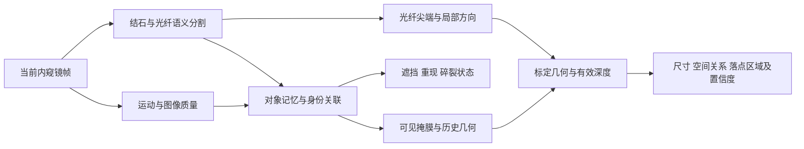

# 当前模型原理与任务适配评估

日期：2026-10-27。依据当前源码、已冻结 A0、两段视频仅验证的 A1_DEV 训练清单、训练日志及下列论文/官方实现。本文分析不改变视频用途；video_1 和 video_2 均不参与有标签训练、无标签训练或伪标签学习。

## 结论与证据边界

当前方案适合保留为少标签条件下的逐帧分割基线，不能认定为完整任务的最优模型。对于跨帧身份、遮挡记忆和三维落点，现有实现缺少必要的状态或观测；更换编码器无法补齐这些信息。

“当前方案不完整”和“某个替代方案已经更优”是两个不同判断。前者由代码可以确认；后者需要相同数据、相同因果约束及目标硬件上的对照实验。目前只有两段开发视频、29 帧稀疏像素真值，没有跨帧实例真值、独立病例测试及真实三维/落点标定真值，不能宣布唯一最优架构。

优先级应为：纠正训练监督 → 确立可靠的单帧基线 → 加入对象记忆与遮挡状态 → 提升端点和几何估计 → 用任务指标选型。当前过度分割不能作为 U-Net 或 Endo-SemiS 整类方法无效的证据。

## 1. 实际运行的网络

项目名称含 SAM，但目前主路径没有实例化 Meta 的 SAM 图像/视频模型。`ureter_semis/model.py` 建立两个相同结构、独立参数的 ResNet34 U-Net：ImageNet 编码器提取多尺度特征，U-Net 解码器通过跳跃连接融合局部细节，最后输出背景、结石、光纤三个互斥类别的 logits。解码器加入 Dropout2d，供训练期不确定度估计使用。

推理在 `ureter_semis/inference.py` 中执行：

\[
P_t=\operatorname{softmax}\!\left(\frac{f_{\theta_1}(I_t)+f_{\theta_2}(I_t)}{2}\right),\qquad
M_t=\arg\max_cP_t(c).
\]

输入为当前帧，当前实验缩放到 256×256；没有输入前一帧掩膜、运动场、历史特征或对象 ID。两套网络都处理同一当前帧，不分别代表前后帧。推理时默认关闭 Dropout，不执行训练期的三次随机采样。

模型因此能够回答“当前可见像素属于哪一类”，无法独立回答“它是否是刚才的同一块结石”“被光纤遮住的两部分是否属于同一实例”。三个类别互斥并不妨碍正常的可见表面分割；但同一像素下的结石与前景光纤、历史完整轮廓，需要独立的状态表达。

代码入口：[模型构建](../../ureter_semis/model.py)、[自定义 U-Net](../../third_party/Endo-SemiS/src/models/unet.py)、[逐帧推理](../../ureter_semis/inference.py)。

## 2. 半监督训练的原理和实现差异

当前实现借鉴 Endo-SemiS，主要用于利用未标注图像，而非直接建立视频记忆：

| 机制 | 本地实现 | 可以解决的部分 | 不能保证的部分 |
|---|---|---|---|
| 有标签监督 | 类别加权 CE + 前景 Dice，255 忽略 | 学习可见类别及像素边界 | 无法从被忽略的区域获得真实背景监督 |
| 不确定度筛选 | 每网在弱增强图上启用 Dropout，3 次预测均值及归一化熵；置信度≥0.85 且熵处于每图较低 80% 区域 | 过滤部分不稳定伪标签 | 低熵不等于正确，稳定的错误也可能保留 |
| 交叉伪标签 | 两网分别学习对方可靠像素 | 利用无标签图像 | 两网可传播共同偏差 |
| 联合伪标签 | 逐像素选择熵较小网络的标签，监督强增强图 | 增强预测一致性 | 不包含前后帧对应或对象身份 |
| 互学习 | 有标签图像 logits 的 MSE，加压缩瓶颈特征的 MSE | 降低两网差异 | 两网一致不能证明语义正确 |

无标签项权重在前 5 轮升至 0.5；本地没有独立的背景充分监督预热阶段。特征一致性也是同一图像两网之间的约束，并非时序特征一致性。

原始 Endo-SemiS 还描述了单独的时空纠错网络，使用中心帧前后各两帧。当前项目没有接入该模块；原论文的多层互学习与损失也没有被逐项原样复现。因而不能直接把原论文结果当作本项目模型的性能。五帧中心窗口依赖未来帧，严格实时因果实现需改造；按 30 FPS 采集，等待后两帧本身约需 67 ms。[论文及 §2.5](https://arxiv.org/html/2512.16977)。

代码入口：[训练器](../../ureter_semis/trainer.py)、[损失](../../ureter_semis/losses.py)、[数据增强](../../ureter_semis/data.py)。

## 3. 本轮训练首先存在监督缺陷

本轮清单为 350 张部分标签、1669 张无标签图像，来自原始两个图像数据集；两段视频的 29 帧全部保留验证。逐张统计 350 张监督掩膜，得到：

| 标签 | 原始掩膜像素数 |
|---|---:|
| 背景 0 | **0** |
| 结石 1 | 9,525,438 |
| 光纤 2 | 194,603 |
| 忽略 255 | 75,271,959 |

这揭示了前面开发实验设置的实质性缺陷：全部未审核背景置为忽略，随后按用户要求移除视频负样本，但没有在原始训练图像中补上背景监督。保留未知区域本身合理，问题在于最终监督只剩前景正例。`supervised_multiclass_loss` 的 CE 和 Dice 均遮蔽 255 像素；模型把被忽略的腔壁预测成结石时，不会受到该区域的真实监督惩罚。无标签伪标签可能包含背景，但并非可靠的独立背景证据。

2026-10-27 本次分析读取到最新完整第 13 轮，在同一 PIL/256×256、29 帧开发验证口径下：

| 指标 | 冻结 A0 | 当前 A1_DEV 第 13 轮 |
|---|---:|---:|
| 结石 Dice | 0.4768 | 0.0421 |
| 光纤 Dice | 0.9699 | 0.9031 |
| 无结石帧出现误检 | 6/9 | 9/9 |

第 13 轮结石精确率约 0.0215、召回率约 0.9953；9 帧无结石画面的有效像素中约 91.3% 被预测成结石。训练损失下降与真实分割改善已经明显脱钩。A0 这里的数字来自同口径 `first_epoch_comparison.json`，不是原图 400×400 的旧报告。

“背景监督缺失可能是当前塌缩的关键原因”是由损失结构和实际输出共同支持的诊断，仍需背景监督消融确认其贡献；不能声称这是唯一原因。纯粹延长训练、调高置信度阈值或换更大编码器均没有补回缺失的背景证据。

修正应只在原始训练图像上进行：保留可信的背景区域与未标注区域的区别，使用有充分背景监督的预热基线，再逐步加入伪标签。若不继续人工审核，可把原始标注背景作为明确声明的暂定监督策略，与保守部分标签策略做开发消融；不能将它标为已审核真值。两段验证视频不能用来补背景负样本，也不能用其预测结果反向训练或蒸馏。

数据与结果：[当前清单](../../datasets/ureter_semis_a1_dev_videos_val_20261027/manifest.json)、[同口径首轮对照及 A0](../../runs/a1_dev_videos_val_20261027/first_epoch_comparison.json)、[训练历史](../../runs/a1_dev_videos_val_20261027/training/history.json)。

## 4. 与完整任务逐项对照

| 目标 | 当前实际能力 | 核心缺口 |
|---|---|---|
| 实时识别结石和光纤 | 双网逐帧三分类；已有推理测速 | 前景/腔壁判别、域偏移、细光纤边界；尚无可靠背景锚点 |
| 结石形态 | 连通域、面积、最小外接矩形、等效直径 | 遮挡后可见形状不等于完整形状；贴近结石可能合并 |
| 结石尺寸 | 光纤直径标尺，可选相对深度修正 | 视角、不同深度、标尺直径定义和真实尺寸验证 |
| 记忆追踪 | 当前无持久跟踪状态；连通域按面积重新排序编号 | 身份关联、重现、遮挡状态、碎裂父子关系 |
| 光纤与结石空间关系 | 光纤最大连通域的 PCA 轴线、二维射线与结石区域关系 | 真正端点、局部出射方向、三维距离及误差传播 |
| 激光落点 | 二维方向外推；可选相对深度下的最近射线点启发式 | 标定后的激光射线、场景表面、真实落点参考及可信度 |

### 4.1 形态、遮挡与追踪

`_stone_components` 将当前掩膜的连通域按面积降序排列，`stone_id` 是当前帧序号，并非持久身份。因此光纤把结石遮成两部分会产生两个区域；两块结石的面积排序变化也会造成 ID 变化。当前量测主要返回射线选中的一个区域，不等于所有结石的历史地图。

需要分别表达可见掩膜、跨帧实例 ID、由历史推测的被遮挡几何，以及遮挡/丢失/重现置信度。可见像素不应被强行填成完整结石；对隐藏区域的推测也不能与当前观测等同。完全遮挡或纹理缺失时，历史不能唯一确定背面形状。

结石真实碎裂与遮挡假分裂还应分开：保留父子实例关系、运动分离及持续性证据，不能用连通域数量增加直接报告碎裂。相关场景研究已经尝试分割加表面点跟踪，但仍存在误报，说明仅有跟踪模块不够。[碎裂感知研究](https://pmc.ncbi.nlm.nih.gov/articles/PMC12963092/)。

### 4.2 尺寸与体积

`_stone_measurement` 返回像素面积、外接矩形长短轴、等效直径和质心。毫米换算主要使用已知光纤直径与图像中的估计宽度之比。光纤和结石近似处于相同深度、已处理成像畸变且标尺宽度可靠时，这可以作为局部近似；若深度不同，简单比例不足。

针孔近似下，对相同图像轴的长度有：

\[
L_{stone}\approx l_{stone,px}\frac{D_{fiber}}{d_{fiber,px}}\frac{Z_{stone}}{Z_{fiber}}.
\]

当前默认相对深度模型不能证明输出等于无偏移的真实逆深度。若其输出存在尺度和偏移不确定性，则直接取倒数、取深度比和以单一尺度换算三维距离并不能自动得到可靠毫米值。官方提供相对模型和另外微调的 metric 模型，后者的现成权重也并非针对灌流内窥镜场景。[Depth Anything V2 官方说明](https://github.com/DepthAnything/Depth-Anything-V2)、[metric 分支](https://github.com/DepthAnything/Depth-Anything-V2/tree/main/metric_depth)。

代码还用短轴代替看不见的第三轴估算椭球体积，这属于形状假设，不是测量到的真实体积。需确认光纤标尺对应可见外径、当前镜型和介质的标定、尺寸及方向误差。尺寸验证应针对已知大小石模并报告偏差和误差区间。

已有 AiFURS 研究采用 YOLOv11-N、BoT-SORT 和光纤参照尺，说明检测、跟踪与标尺可分层实现；但该检测框管线并不替代像素轮廓，也不证明本项目的深度或落点估计。其尺寸实验有受控观察条件，不能把结果直接移植到自由视角下。[研究全文](https://pmc.ncbi.nlm.nih.gov/articles/PMC12661004/)。

### 4.3 激光落点

`_fiber_ray` 用整段光纤的 PCA 主轴估方向，并以更靠近图像边缘的端作为近端；端部采用投影分位数，并非训练过的真实尖端关键点。这在光纤弯曲、倾斜、遮挡或离开图像边缘时可能偏离真正的出射点与方向。

`_laser_target` 在二维射线附近寻找结石像素；深度路径则把相对深度反投影后，沿图像射线采样，选择与估计三维射线最近的点。最近点启发式不是经过验证的物理表面相交；没有距离阈值和可信度时，几何算法仍可能选出一个不可靠候选。

可验证的三维预测至少需要激光原点与方向形成的射线，以及与其处于同一坐标系、经标定的表面几何：

\[
X(\lambda)=X_{tip}+\lambda d_{laser},\quad \lambda\ge 0,\qquad X(\lambda)\in\mathcal S.
\]

单帧 RGB 掩膜不能唯一恢复这两者。分割模型即使完美，也不能凭空提供真实出射方向或米制深度。应单独建立光纤尖端/局部轴线估计、镜头与激光几何标定，并用台架已知落点做验证；若有可见瞄准光，可单独检测，并测定其与治疗激光落点的关系。输出应包含落点区域、置信度和无有效预测状态，不能始终显示一个确定点。

代码入口：[几何与量测实现](../../ureter_semis/demo.py)、[相对深度封装](../../ureter_semis/depth_anything_v2_infer.py)。

## 5. 候选模型与适用位置

以下是值得对照的候选，不是已经在本项目证明优于 A0 的模型。

| 候选 | 适用位置 | 本项目中应验证的限制 |
|---|---|---|
| 现有 U-Net 单网/双网 | 自动识别结石与光纤的轻量基线 | 正确监督下的性能；单网是否可节省延迟且不显著损失精度 |
| SegFormer-B0/B1 | 另一类具有全局上下文的语义分割骨干 | 小数据泛化、细光纤边界和实际延迟；本身没有跨帧记忆 |
| Cutie | 给定高可信对象初始掩膜后的记忆传播、重现 | 不能自行保证结石语义；错误初始掩膜会污染记忆 |
| SAM 2.1 Tiny/Small | 可提示的视频掩膜与对象记忆 | 需自动提示与语义复核；新目标和碎裂须单独处理 |
| SAM 3 / SAM 3.1 | 概念提示检测、分割和多对象追踪的较完整对照 | 内窥镜语义域、细小光纤、显存与端到端延迟尚未验证 |
| CoTracker3 等点跟踪 | 表面点运动与碎裂辅助证据 | 点轨迹不等于对象掩膜；窗口版在线接口可能有等待延迟 |

官方来源：[SegFormer](https://github.com/NVlabs/SegFormer)、[Cutie](https://github.com/hkchengrex/Cutie)、[SAM 2](https://github.com/facebookresearch/sam2)、[SAM 3](https://github.com/facebookresearch/sam3)、[SAM 3.1 发布记录](https://github.com/facebookresearch/sam3/blob/main/RELEASE_SAM3p1.md)、[CoTracker](https://github.com/facebookresearch/co-tracker)。

SAM 2 和 Cutie 的对象记忆与当前逐帧模型不同，适合直接对照遮挡重现。SAM 3 家族加入概念检测与追踪；截至本次检索，官方还已发布 SAM 3.1 的共享记忆多对象跟踪。这使其成为值得评估的候选，并不等于“输入 stone 或 fiber 文本就能可靠解决术中分割”。

公开的 SAM 2 FPS 表使用 A100 及特定编译条件，不应直接作为本机 RTX 4070 Ti 12GB 的速度。本地 A0 已有约 7 ms 的双网纯模型推理记录，说明单帧分割计算不是唯一矛盾；视频采集、传输、记忆、深度、几何与渲染的端到端延迟仍需测量。若目标为 30 FPS，每帧总预算约 33.3 ms，平均 FPS 也不能代替延迟分位数和事件响应时间。

## 6. 更适合本任务的系统形式

推荐把完整系统分为相互校验的模块，而不是让一个三分类网络承担全部任务：

语义分割为记忆提供候选，记忆对当前结果提供历史支持；两者冲突时应结合运动、视野和图像质量降低置信度，避免错误写入永久记忆。新目标入镜与真实碎裂保留独立入口，不能被历史掩膜永久否决。只允许当前及过去帧的路径用于严格因果实时对照；双向传播和未来窗口另列。

光纤可在语义掩膜上增加高分辨率尖端关键点及局部切线估计，不必将细线形工具和大块结石强行用同一种形状后处理。高分辨率/局部精修是否值得引入，应由尖端像素误差和毫米误差决定。

## 7. “最优”应如何判定

候选选择需在固定的训练数据和验证用途下比较，并保留同样的类别语义、输入预处理、因果性和硬件条件。

| 维度 | 必需指标 |
|---|---|
| 语义分割 | 每类 Dice/IoU、结石精确率与召回率、边界指标、负帧误检面积与持续时间 |
| 光纤几何 | 尖端位置误差、局部方向角误差、宽度误差 |
| 记忆追踪 | ID 切换、遮挡重现成功率、失跟持续时间、误分裂及真实碎裂召回 |
| 尺寸 | 毫米 MAE、偏差及误差区间、不同深度/姿态下的稳定性 |
| 落点 | 像素与毫米误差、置信区域覆盖、无有效预测时的行为 |
| 实时性 | 完整管线 P50/P95 延迟、丢帧率、显存及新事件响应延迟 |

当前两段视频的稀疏真值可以支持开发筛选，不能支持上述全部验收；不应将无真值时间平滑程度当作真实准确率。后续如有新增病例，应单独保留为最终测试。已有 video_1/video_2 始终只验证，不通过伪标签、蒸馏或相邻帧抽样回流到训练。

最终判断：保留现有模型作为可复现的单帧对照；优先纠正背景监督，随后比较轻量语义分割加对象记忆，并单独验证标定几何。当前无法合理地把继续训练双 U-Net、直接换 SAM、或单纯加入面积平滑称为完整任务的最优方案。
