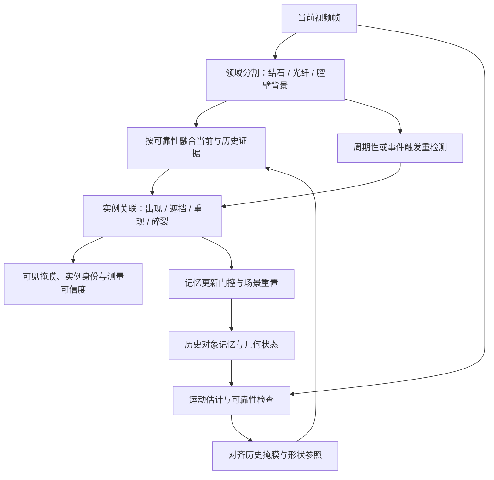

# UreterSAM：时序一致性、几何记忆与遮挡处理调研

检索与代码核验日期：2026-10-26。本文区分论文结论、公开代码现状、本地项目事实与针对本项目的设计建议。未运行外部模型，文献中的速度和精度不能视为 UreterSAM 上的实测结果。

## 1. 结论与优先级

建议把系统从“逐帧语义分割 + 连通域计数”升级为“领域分割 + 运动对齐 + 目标级记忆 + 遮挡状态 + 重检测”。先建立容易验证的改进基线，再比较更强的视频模型。

1. **必须同步处理数据问题。** 当前训练、验证、测试图像全部包含结石，缺少整帧无结石的腔壁负样本；`laser` 与真实光纤被合并；新增数据的 `stone-new` 尚未映射。时序传播可能使这些语义错误持续更久。
2. **首先建立现有模型的因果时序基线。** 使用光流对齐上一帧概率图，结合匹配可靠性进行融合；维护结石实例身份和短期遮挡状态；记录误检、漏检、恢复、碎裂事件。
3. **首选视频记忆对照：Cutie；解耦架构参考 DEVA。** Cutie 有明确的逐帧状态接口，便于保留现有分割模型；DEVA 明确支持接入自定义图像模型，但在线与半在线设置要分开比较。[Cutie](https://github.com/hkchengrex/Cutie)、[DEVA](https://github.com/hkchengrex/Tracking-Anything-with-DEVA)。
4. **更强手术域对照：SurgSLOT-SAM2。** 其语义身份与长期记忆筛选贴近“避免漂移到腔壁、遮挡后找回同一目标”的需求；已有训练、推理实现与权重入口。它依然是提示驱动方法，需要自动初始化和新目标发现机制。[论文](https://arxiv.org/abs/2511.16618)、[代码](https://github.com/jinlab-imvr/SurgSLOT)。
5. **有连续视频标注后，再训练因果时序网络。** 借鉴 SSTAN、PNS+ 或时序递归结构，把运动和历史特征纳入学习；这与仅对最终掩膜做平滑是不同层次的改进。

上述排序是基于项目接入成本、在线要求与公开实现完整度的工程判断，不是跨论文性能排名。

## 2. 三类问题应分别定位

| 现象 | 当前项目事实 | 需要补充的能力 |
|---|---|---|
| 腔壁突然变成大块结石 | 单帧预测；缺少整帧无结石负样本；没有实例级历史核验 | 学会目标不存在；领域判别；历史外观与运动核验；可靠重检测 |
| 结石忽隐忽现、面积跳变 | 双模型融合仍是同一帧内的融合；没有跨帧状态 | 运动补偿、概率/特征传播、长短期记忆、异常与失跟处理 |
| 光纤遮挡后变形或被计成两颗 | 三分类掩膜中光纤覆盖结石是合理的可见性表达；下游把每个连通域独立计为结石 | 一个实例允许多个可见连通片；显式遮挡状态；独立维护历史几何 |

**可见掩膜、物体身份和完整形状必须分开。** 一颗结石被光纤挡住后，正确的可见掩膜可以不连通，但物体身份仍是同一个。补全光纤背后的完整形状属于 amodal segmentation，应另外输出推测区域与置信度，不能直接覆盖可见语义标签。结石真正碎裂时，则应允许一个实例产生多个子实例。

本地核验依据：`ureter_semis/trainer.py` 保存 `use_temporal=False`；`data.py` 按独立图像采样；`demo.py` 的 `_stone_components` 按连通域提取结石；`realtime_compare.py` 没有持久实例状态。当前有标签/无标签训练图像共 1236 张，全部含结石；验证 117 张和测试 58 张也全部含结石。原始标注中共有 123 张图像存在 `laser`、不存在 `fiber`，这些激光标签已转换为类别 2。

## 3. 与输尿管镜最直接相关的文献

### 3.1 MI-UNet 与 HybResUNet + DVFNet

- **MI-UNet: improved segmentation in ureteroscopy，ISBI 2020。** 用学习到的运动信息辅助 U-Net，面向碎屑、遮挡、照明变化等输尿管镜问题。[Oxford 作者机构页面](https://hmc.ox.ac.uk/node/1518396)。
- **Multi-class motion-based semantic segmentation for ureteroscopy and laser lithotripsy，CMIG 2022；预印本 2021。** HybResUNet 与 DVFNet 联合利用五帧训练结石/光纤分割。需要注意，论文方法部分明确说明：DVFNet 只在训练时使用，测试仍逐帧运行 HybResUNet。因此它支持“运动监督有价值”，不能作为推理阶段已经拥有历史记忆的证据。[正式发表记录](https://ora.ox.ac.uk/objects/uuid%3A0dbe1084-383c-4969-b345-6f74a7f395b8)、[全文 §3.2.4](https://arxiv.org/html/2104.01268v1)。

本轮未核实到上述专用框架的完整官方可复现代码。不要把论文引用的通用 U-Net 仓库当作该方法的官方实现。

### 3.2 Endo-SemiS 原论文的时空纠错模块

原论文 §2.5 并非完全不考虑时序：它根据相邻帧前景面积发现孤立 FP/FN，并以中心帧前后各两帧的图像与掩膜训练独立纠错网络。当前 UreterSAM 没有实现这一路径；本地第三方 `train_kidney.py` 中虽然出现 `model3/net3` 参数，但不能据此认定已有可用的论文纠错模块。[论文 §2.5](https://arxiv.org/html/2512.16977)。

适用边界：主要处理孤立整帧误检/漏检；面积假设不适合直接照搬到小碎片、快速进出视野和真实碎裂。中心五帧窗口使用未来信息：若按 30 FPS 连续输入，需要等待至少两帧，约 67 ms，另加计算时间。严格因果实现需改用历史窗口并重新训练、评估。

### 3.3 分割、点跟踪与真实碎裂

**Detection of fragmentation while dusting during retrograde intrarenal laser lithotripsy，Lasers in Medical Science 2026。** 采用 CLIPSeg + LoRA、CoTracker 与 HDBSCAN 分析结石表面点的变化，提供了利用轨迹区分碎裂事件的直接场景依据。但报告的帧级 F1 仅 0.568，片段级 F1 0.124；论文讨论指出遮挡、运动及聚类变化会带来大量误报。[论文](https://pmc.ncbi.nlm.nih.gov/articles/PMC12963092/)。

工程启示：可以引入表面点运动作为“是否真实分裂”的证据，不能把跟踪失效或连通域数增加直接解释成碎裂。本轮未发现该完整管线的官方公开代码入口，CoTracker 本身有官方实现。

## 4. 候选方法与公开代码比较

| 方法与出处 | 关键机制 | 对 UreterSAM 的用途 | 核实到的代码与限制 |
|---|---|---|---|
| [XMem，ECCV 2022](https://arxiv.org/abs/2207.07115) | 感觉、工作、长期记忆；压缩历史特征 | 长视频状态和重现识别的基础对照 | [官方代码](https://github.com/hkchengrex/XMem)；需要初始对象掩膜，不负责自动判定结石语义 |
| [Cutie，CVPR 2024](https://arxiv.org/abs/2310.12982) | 对象级查询与像素级记忆结合，前景/背景注意力 | 维持结石身份，降低相似背景干扰；逐帧接入 | [官方代码](https://github.com/hkchengrex/Cutie)；有 `InferenceCore.step`、新增/删除对象和记忆清理接口；仍需自动种子、重检测与可靠更新策略 |
| [DEVA，ICCV 2023](https://arxiv.org/abs/2309.03903) | 任务分割与通用时间传播解耦 | 最大程度复用当前 U-Net，作为接入架构参考 | [官方代码](https://github.com/hkchengrex/Tracking-Anything-with-DEVA)；自定义检测接口明确；半在线会使用缓冲/双向传播；作者明确提醒正误检也会被传播放大 |
| [SAM 2 / SAM 2.1](https://ai.meta.com/research/sam2/) | 流式记忆、对象提示与视频传播 | 强视频分割基线、视频标注工具基础 | [官方代码](https://github.com/facebookresearch/sam2)；现成视频接口与模型“streaming memory”不是同一概念，摄像头输入和有界状态管理需要单独核验 |
| [SAMURAI，2024 预印本](https://arxiv.org/abs/2411.11922) | Kalman 运动预测参与候选掩膜与记忆筛选 | 面积/位置突变核验，运动与语义联合选掩膜 | [官方代码](https://github.com/yangchris11/samurai)；README 明确现成代码暂不支持实时摄像头流；框运动不能独立解决细轮廓和遮挡身份问题 |
| [SAM2Long，ICCV 2025](https://arxiv.org/abs/2410.16268) | 维护多个历史分割路径，约束树搜索 | 研究如何避免一次错误污染后续记忆 | [官方代码](https://github.com/Mark12Ding/SAM2Long)；论文完整视频最优路径在视频结束后选择，不能直接当作严格实时结果；主体代码为 CC-BY-NC 4.0 |
| [SurgSAM2，2024](https://arxiv.org/abs/2408.07931) | 手术域适配与高效帧记忆裁剪 | 手术视频速度/记忆管理参照 | [官方代码](https://github.com/jinlab-imvr/Surgical-SAM-2)；README 的训练章节仍标注待发布，不按完整训练方案推荐 |
| [MA-SAM2，MICCAI 2025](https://papers.miccai.org/miccai-2025/paper/2634_paper.pdf) | 上下文记忆 CAM 与遮挡鲁棒记忆 ORM | 遮挡期间筛选记忆、减少身份漂移的直接参考 | [官方代码](https://github.com/Fawke108/MA-SAM2)；本轮仓库只有一个主要 predictor 文件，缺少与其接口匹配的完整基础实现，接入成本高于 README 给人的印象 |
| [TSMS-SAM2，2025/2026](https://pmc.ncbi.nlm.nih.gov/articles/PMC12830041/) | 多时间尺度采样；长短期记忆拆分和裁剪 | 手术运动速度变化、记忆容量管理 | [官方代码](https://github.com/apple1986/TSMS-SAM2)；可见训练、模型和配置文件；结石域需新验证 |
| [SurgSLOT，2025 预印本，2026 修订](https://arxiv.org/abs/2511.16618) | 稳定语义身份、可靠候选筛选、语义驱动长期记忆 | 遮挡重现、相似腔壁干扰、长期漂移；优先强基线 | [官方代码](https://github.com/jinlab-imvr/SurgSLOT)；SAM2/SAM3 两分支；已有训练/推理与权重链接；不是自动结石识别器，尚需领域初始化；各分支许可不同 |
| [SASVi，IPCAI / IJCARS 2025](https://pmc.ncbi.nlm.nih.gov/articles/PMC12226634/) | 领域 Overseer 监控目标进出并重提示 SAM2 | 新结石发现、失跟重初始化、纠正视频传播 | [官方代码](https://github.com/MECLabTUDA/SASVi)；回溯更正历史帧与立即输出当前帧需区分；当前语义 U-Net 也不等同论文的实例 Overseer |

自然视频、手术器械、结肠镜病灶与输尿管结石之间存在域差异。这张表比较机制与可复用程度，不比较不同数据集上不可直接对齐的分数。

## 5. 可训练时序结构与新近研究

| 方法 | 可借鉴内容 | 复现状态与适用边界 |
|---|---|---|
| [PNS+ / SUN-SEG，MIR 2022](https://arxiv.org/abs/2203.14291) | 长期锚帧与短期连续帧联合注意力；按困难属性评估 | [代码](https://github.com/GewelsJI/VPS)含训练、测试、权重与数据申请说明；属于结肠镜域；连续片段输入须审计是否有未来帧 |
| [SSTAN，MICCAI 2022](https://conferences.miccai.org/2022/papers/460-Paper0482.html) | 时间局部上下文及邻帧时空注意力 | [实际公开仓库](https://github.com/ShinkaiZ/SSTAN-VPS)注明为 SUN-SEG 全监督版本，不能视为原论文半监督流程全部公开 |
| [PolypNextLSTM，IJCARS 2024](https://pmc.ncbi.nlm.nih.gov/articles/PMC11442634/) | 轻量编码器 + ConvLSTM 时间融合 | [代码](https://github.com/mtec-tuhh/PolypNextLSTM)；原结构为双向 ConvLSTM，需尾端输出、窗口延迟或因果重训练方案 |
| [STDDNet，ICCV 2025](https://openaccess.thecvf.com/content/ICCV2025/html/Chen_STDDNet_Harnessing_Mamba_for_Video_Polyp_Segmentation_via_Spatial-aligned_Temporal_ICCV_2025_paper.html) | 空间对齐后建立时间依赖，利用动态差异改善细节 | [代码](https://github.com/C-GLGLGL/STDDNet)有训练/测试及权重入口；README 指向 Linux 的 Mamba/CUDA 扩展，当前 Windows 环境接入成本较高；双向片段处理需核验延迟 |
| [WavePolyp，ICLR 2026](https://proceedings.iclr.cc/paper_files/paper/2026/hash/dd42e330ac1a820dfcac1876a361d6ff-Abstract-Conference.html) | 频率特征与帧间差异建模，针对相似黏膜与时间变化 | [仓库](https://github.com/FishballZhang/WavePolyp)经递归文件树核验目前只有 README，仍为待发布代码，暂不列复现优先项 |
| [FST-SAM3，ECCV 2026 目录记录](https://link.springer.com/book/10.1007/978-3-032-37032-7) | 作为新近视频息肉分割方向继续跟进 | [仓库](https://github.com/GavonW/FST-SAM3)目前只有 README；本轮未据此提出实现细节或性能判断 |

训练建议：由真实有序视频采样历史窗口，使几何增强在窗口内一致；针对光纤移动、烟尘、反光和运动模糊设计增强；保留负样本；时间一致性损失只作用于可靠对应且可见的像素。遮挡区、出入视野区与碎裂事件区不能强制前后相等。这里是针对本项目的设计建议，不是声称某个现成模型已解决全部问题。

## 6. 遮挡补全与几何记忆

### 6.1 首先维护目标身份，不强制可见掩膜连通

建议每个结石对象维护以下独立状态：

- `track_id`：跨帧身份，可对应多个可见连通片。
- `visible_mask`：当前真正可见、可以参与语义评估的区域。
- `shape_prior`：来自清晰历史帧、经运动补偿的形状参照。
- `occlusion_mask` / `visibility`：光纤遮挡、其他遮挡以及可见程度；光纤掩膜只有在与历史结石空间相交时才提供该结石被遮挡的证据。
- `geometry_state`：历史中心、轮廓、尺度、形状及其不确定性；面积要考虑相机运动、缩放和视角，不能约束像素面积恒定。
- `parent_id` / `event`：真正碎裂后建立父子关系，而不是永久强制一颗结石只能有一个身份。

光纤占据的像素继续属于光纤，可在“完整形状推测层”中同时落入某颗结石的隐藏部分。互斥三分类图与允许重叠的实例几何层应使用不同数据结构。

### 6.2 完整形状预测的研究边界

[Using Diffusion Priors for Video Amodal Segmentation，CVPR 2025](https://diffusion-vas.github.io/)及其[官方代码](https://github.com/Kaihua-Chen/diffusion-vas)利用视频生成先验，推测被遮挡的掩膜及外观。这类方法说明任务可被专门建模，但生成的隐藏几何仍需单独验证，不能当作毫米尺寸真值。

[OccJEPA，2026-10-21 预印本](https://arxiv.org/abs/2610.29061)使用 V-JEPA 表征预测隐藏区域；[代码](https://github.com/zgp110/occjepa)已出现训练与推理文件。它是检索日刚发布五天的工作，且不是输尿管镜研究，作为后续观察方向，不作当前首轮工程依赖。

首轮更适合使用：历史清晰轮廓、可靠运动对齐、光纤遮挡约束及置信度衰减。完全遮挡时保留身份，但允许当前可见区域为空；缺乏可靠证据时暂停更新尺寸，而不是把历史完整轮廓画成当前已观测事实。

### 6.3 光流、点跟踪与三维几何的角色

- [RAFT 官方实现](https://github.com/princeton-vl/RAFT)、[torchvision RAFT](https://github.com/pytorch/vision/blob/main/torchvision/models/optical_flow/raft.py)：用于相邻帧运动对齐。应检查前后向一致性、越界和遮挡，不能在粉尘或反光下无条件信任流场。已有 torchvision 环境使它适合做首轮实验对照。
- [CoTracker3 官方实现](https://github.com/facebookresearch/co-tracker)：可提供结石表面点轨迹与可见性，有在线分块处理入口。点跟踪不直接输出结石掩膜，在线分块也需要测量窗口等待时间。
- 三维投影约束只有在相机参数、深度、位姿及其坐标系可靠时才能成立。当前相对深度与 Godot 相机参数不构成真实手术中的稳定度量三维状态；先建立二维运动一致性，再验证三维模块。相机运动估计失败时应降低几何约束权重。

## 7. 建议的 UreterSAM 在线结构

以下为待验证设计，不是已完成的实现。

### 7.1 当前预测与历史预测的融合

先对齐，再融合；不要对固定图像坐标直接滑动平均。设当前概率为 `P_t`，历史传播结果为 `Q_t`，使用空间变化的可信度决定两者权重：运动可靠、历史身份稳定时使用更多历史证据；遮挡、流场错误、视野变化时减弱传播证据。低可靠时允许拒绝给出稳定测量。

同时保留新目标通道。历史中没有对应的区域不应永远被抑制；对新结石候选使用独立的领域置信度、外观与短期证据验证。真实碎片可以只持续几帧，不能用过长的固定确认窗口过滤全部新目标。

### 7.2 记忆更新门控

只把足够可靠的观测写入长期记忆；结合领域语义、历史外观、运动匹配和可见程度判断。单纯 softmax 高置信度不代表正确。

出现可疑的大面积扩张、突变、严重遮挡、粉尘或失跟时，可以暂缓长期形状更新，并触发独立重检测；短期状态仍允许真实运动和形变。不同对象、短期记忆、长期清晰参照分别维护。切镜、退出腔体、较大场景变化后重置或重新核验。

[Cutie 的对象级机制](https://arxiv.org/abs/2310.12982)、[SAMURAI 的运动筛选](https://arxiv.org/abs/2411.11922)、[SurgSLOT 的语义原型筛选](https://arxiv.org/abs/2511.16618)分别为上述不同部分提供依据；这里的组合属于本项目方案推导。

### 7.3 遮挡与真实碎裂的区分

遮挡解释：当前两片可见区域都匹配同一历史对象，缺失区与光纤遮挡位置相符，且可见表面运动相容，可以维持同一身份。

碎裂解释：子区域出现持续相对运动、可见间隙与表面点轨迹分离等多种证据时，允许分裂并记录父子关系。不能仅由距离、细长光纤或连通域数量决定。外观相似的两颗相邻结石也不能因为靠得近而合并。

### 7.4 数据与训练先决条件

1. 从真实视频建立 `video_id / patient_id / frame_index / timestamp`，按病例或视频划分。现有无序图片不能仅凭 Roboflow 文件名排列成真实连续序列。
2. 补充整段无结石腔壁、反光黏膜、浑浊和黑边负样本；保留连续入镜和出镜过程。显式增加 tissue 类是可评估选项，不是唯一前提。
   新增 `stone_new.v4i.yolov8` 共 1436 张图像，其中 1000 张含 `stone-new` 标注；其余 436 张可优先审查是否可用作负样本，不能仅因缺少该类标注就自动认定没有结石。
3. 将真实光纤与激光光斑分开；修复 `stone-new` 映射；检查标签是否覆盖可见目标而非遮挡后的想象轮廓。
4. 标注少量短视频的实例身份、遮挡比例和真实碎裂事件；不必先为所有视频逐帧密集标注。
5. 半监督训练时只在可靠可见对应上增加时序一致性；清晰历史教师和困难当前帧可以使用不同可信度。新显露区域与真正碎裂区域应减少历史约束。

## 8. 公开代码核验记录

本节只说明静态阅读发现，未声称已安装或运行成功。

| 仓库 / 文件 | 核验发现 |
|---|---|
| [Cutie `inference_core.py`](https://github.com/hkchengrex/Cutie/blob/main/cutie/inference/inference_core.py) | `step` 接收当前图像、可选对象掩膜与身份列表；有永久参照、对象删除和记忆清理能力。但没有可直接等同“全部质量门控已实现”的通用开关，需要审计工作记忆和感觉状态的更新路径 |
| [DEVA 自定义接口](https://github.com/hkchengrex/Tracking-Anything-with-DEVA/blob/main/docs/CUSTOM.md) | 明确描述接入自有图像检测/分割模型的方法；需把当前语义输出转成带身份与元信息的对象假设；README 记录了误检传播和对象累计问题 |
| [SAMURAI `sam2_base.py`](https://github.com/yangchris11/samurai/blob/master/sam2/sam2/modeling/sam2_base.py) | Kalman 预测确实参与掩膜选择，并有对象/运动分数筛选记忆的代码；README 明确暂不支持摄像头流 |
| [SurgSLOT `surgslot_video_predictor.py`](https://github.com/jinlab-imvr/SurgSLOT/blob/main/surgslot-sam2/sam2/surgslot_video_predictor.py) | 有每对象语义原型、置信门控、候选缓冲、按原型相似度选长期帧；默认长期 3 帧、候选 5 帧、原型 EMA 0.95。注意其 `sam2_base.py` 是基础类，不能只读基础类就遗漏真正的 SurgSLOT 实现 |
| [MA-SAM2](https://github.com/Fawke108/MA-SAM2) | 文件树只有一个主要 Python predictor；其 `track_step` 调用传入 `init_cond_frame_idx / start_frame_idx / iou_thre` 等参数，当前官方 SAM2 基础接口并不对应。完整复现还需解决基础类版本与额外返回值匹配，不能只覆盖一个文件就认定可用 |
| [SurgSAM2](https://github.com/jinlab-imvr/Surgical-SAM-2) | 有评估权重入口，但训练说明仍写代码待发布 |
| [SSTAN-VPS](https://github.com/ShinkaiZ/SSTAN-VPS) | README 明确公开的是全监督版本，需要与“半监督”论文标题区分 |
| [STDDNet](https://github.com/C-GLGLGL/STDDNet) | 有训练、测试、权重入口；依赖特定 Mamba 与 CUDA 编译组件，README 提供 Linux wheel，不能假定可直接装入当前 Windows 环境 |
| [WavePolyp](https://github.com/FishballZhang/WavePolyp) / [FST-SAM3](https://github.com/GavonW/FST-SAM3) | 经递归文件树核验都只有 README，没有公开可执行模型实现 |

核验时的部分 Git 树 SHA：SurgSLOT `b8565436ec6ade7a56840bbcd2f369566b6daad6`；MA-SAM2 `bc3de3dffa14d6fb3e93d91a43383ad5f8052d28`；TSMS-SAM2 `24666e2a38ebbbaa414bb599ac4a9bc597c675ba`；WavePolyp `72a6bc4a447b33773c681af36ac13b197e0bae17`；FST-SAM3 `ec017e58cc1bbc0eed64ee5752a6a88cc9e5f5fd`。

## 9. 实验顺序与评价协议

### 9.1 三组主对照

| 组别 | 方案 | 目的 |
|---|---|---|
| A | 当前双 U-Net 原样运行 | 保留可复现基线 |
| B | A + 可靠运动补偿 + 概率融合 + 实例状态/遮挡管理 | 判断轻量增加历史信息是否足够；做各模块消融 |
| C1 | 当前领域模型提供高可靠初始化/重检测 + Cutie | 验证可直接逐帧调用的视频记忆模型收益 |
| C2 | 同等自动提示条件下的 SAM2.1 / SurgSLOT-SAM2 | 判断手术域语义长期记忆是否提供额外收益 |

先增加一个“正确人工初始掩膜”的上界对照，以区分初始化错误和传播错误；正式自动系统结果必须使用同等自动提示条件，不能拿人工首帧提示结果直接与全自动 U-Net 比较。对新目标与完全无结石片段要单独测试。

### 9.2 除 Dice / IoU 外必须报告

- **腔壁误检：** 无结石帧误检率、误检面积占有效视野比例、一次误检持续时间、误检被记忆放大的频次。
- **运动补偿后的时间稳定性：** 在可靠可见对应区统计标签不一致率/warp IoU；另报真实变化响应，防止“永远输出同一错误掩膜”看似更稳定。
- **实例身份：** 遮挡前后身份保留率、身份切换、错误合并、错误分裂；可用 IDF1/HOTA 等作补充，但需先定义实例与碎裂父子标注协议。
- **遮挡性能：** 按光纤遮挡程度、完全遮挡、重现阶段分别统计；报告可见掩膜精度和恢复所需帧数。
- **真实碎裂：** 碎裂事件召回、误报、延迟；统计时间约束错误抑制真实碎片的情况。
- **几何：** 可见与历史推测的尺寸分别评价，统计遮挡引起的尺寸偏差与恢复；没有真实尺寸时仅报告稳定性，不能把平稳等同准确。
- **在线资源：** 原始帧率、计算吞吐、P50/P95 端到端延迟、未来帧等待、显存及长视频增长。逐帧标注、光流、深度和显示的时间应计入完整管线。

需要覆盖腔壁、结石入镜/出镜、相机快速运动、光纤横穿、部分/完全遮挡、粉尘/出血/反光、多结石及真实碎裂。按病例/视频划分，并以视频或病例为单位汇总区间，避免相邻帧同时进入训练和测试。

## 10. 建议的后续代码落点

以下名称是建议新增模块，不代表已经存在：

- `ureter_semis/temporal.py`：有界状态、运动补偿、可靠性、可替换记忆后端。
- `ureter_semis/tracking.py`：实例身份、多连通片、遮挡、重现及碎裂关系。
- `ureter_semis/data.py`：增加真实视频片段采样与连续增强，保留现有单图数据接口。
- `ureter_semis/trainer.py`：按需增加时序特征或可靠对应约束；现有双网络同帧一致性不应被重新命名为时序一致性。
- `ureter_semis/demo.py` / `realtime_compare.py`：使用同一个带状态推理入口，避免两条演示路径行为不同。
- 测量模块：基于持久实例与可见性判定是否更新尺寸，替换“每帧每个连通域就是一颗结石”的假设。
- 独立视频评估入口：保存每帧概率、可见掩膜、实例身份、遮挡状态、事件及耗时，支持回放和消融。

首轮交付应是同一批真实视频上的基线与 B/C 对照，明确误检传播、遮挡恢复和真实碎裂响应的得失，再决定最终网络替换与训练投入。
