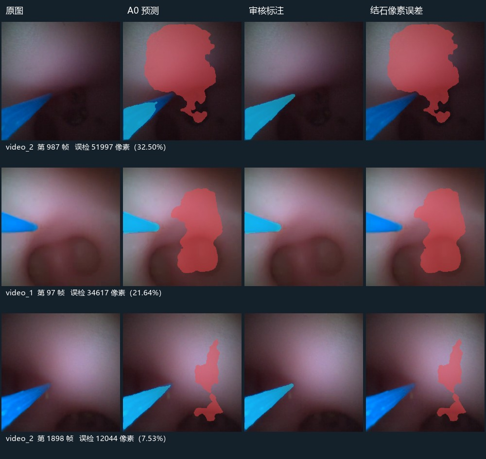

# A0 在已审核视频关键帧上的基线评价

日期：2026-10-27。使用已审核的 29 帧，覆盖两个不同病例；均为开发材料，训练来源独立性尚未核实。

29 帧像素审核通过，其中 22 帧经修订、7 帧与原模型预标注相同，共修订 168437 个像素。20 帧存在可见结石，9 帧确认无可见结石。实例身份审核仍未通过，因此不计算身份保留、错误分裂或遮挡恢复成功率。

| 范围 | 帧数 | 结石 Dice | 结石 IoU | 结石 Precision | 结石 Recall | 光纤 Dice |
|---|---:|---:|---:|---:|---:|---:|
| 全部审核帧 | 29 | 0.4840 | 0.3192 | 0.3554 | 0.7583 | 0.9771 |
| 病例 video_1 | 20 | 0.5839 | 0.4124 | 0.4196 | 0.9597 | 1.0000 |
| 病例 video_2 | 9 | 0.3856 | 0.2389 | 0.2894 | 0.5777 | 0.9333 |
| 有可见结石 | 20 | 0.7978 | 0.6636 | 0.8415 | 0.7583 | 0.9755 |
| 无可见结石 | 9 | 0.0000 | 0.0000 | 0.0000 | 未定义 | 0.9803 |
| 用户报告腔壁误检区间内关键帧 | 11 | 0.1259 | 0.0672 | 0.0685 | 0.7703 | 1.0000 |
| 用户报告遮挡区间内关键帧 | 6 | 0.9931 | 0.9862 | 1.0000 | 0.9862 | 1.0000 |

无可见结石的 9 帧中，8 帧仍有结石预测；这些帧的平均误检面积占有效标签区域的 7.82%。这是故障富集、稀疏选帧的统计，不代表整段视频误检频率。

## 误检示例

以下图从已审核无结石帧中选择预测结石像素最多的三帧。红色表示结石假阳性，蓝色表示结石漏检，紫色表示未知像素。显示编号从 1 开始。

## 评价边界

- 在原视频 400×400 网格上评价，A0 256×256 预测采用最近邻放大；255 未知像素被忽略。
- 没有单独人工视野掩膜时，以有效标签区域为分母；不能把面积比例称为纯腔壁区域误检率。
- 真值经过模型预标注辅助审核，尚无独立盲标对照；不把高光纤分数解释为独立验证结果。
- 事件分层只对落在用户报告区间的已审核帧计算；区间未标注帧不计入，事件子组可能重叠。
- 本批 29 帧保持开发评价用途，不自动加入训练，也不按相邻帧随机拆成独立测试病例。

遮挡区间的 6 帧像素 Dice 较高，不代表实例与遮挡问题已经解决：其中多帧与原模型预标注一致，且可见掩膜重叠不能判断一颗结石是否被错误计成两颗，也不能判断历史几何是否稳定。实例审核仍待完成。

## 下一步

用户选择继续原顺序：审核训练数据及来源分组，形成 A1 清单后重训；A1 单帧对照通过后再进入 S3 时序实验。当前工作台新增独立的标签审核状态，允许先确认标签、保留来源待审。

当前快照为 `_v2`；`_v1` 保留为首次 A0 专用快照。`_v2` 同时保存视频身份，允许后续 A1 使用相同审核真值进行对照，而不锁定模型配置。

原始结果：[a0_metrics.json](a0_metrics.json)，分层结果：[stratified_metrics.json](stratified_metrics.json)，标注快照：[pixel_reviews.json](pixel_reviews.json)。
